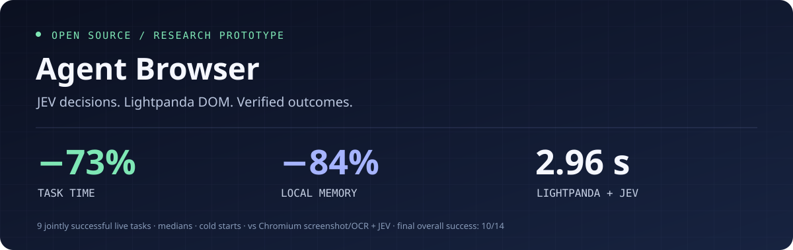

<p align="center"></p>

<p align="center">
  <a href="LICENSE"></a>
  
  
  <a href="https://github.com/lightpanda-io/browser"></a>
</p>

# Agent Browser Runtime

**Web automation built around structured observations, typed decisions, and independently verified results.**

An experimental browser execution layer for AI agents: observe the page through DOM controls, let [JEV](https://typesafe.ai/) choose the next action, execute it with [Lightpanda](https://github.com/lightpanda-io/browser), and verify the actual outcome. Chromium DOM and screenshot/OCR paths provide comparison baselines.

The broader design leaves high-level planning to an LLM and delegates bounded browser decisions to JEV. The published experiments exercise the JEV execution layer; they do not benchmark an LLM planner.

## The numbers

### Live websites · cold browser starts · matched tasks

**73% less task time. 84% less local memory.** Compared with the Chromium screenshot → local OCR → JEV pipeline, on the **same nine tasks completed by all three approaches**:

| Execution path | Median task time | Median local peak memory¹ | Browser-only peak memory¹ | Final success² |
| :--- | ---: | ---: | ---: | ---: |
| Chromium + screenshot/OCR + JEV | 11.07 s | 538.69 MiB | 386.71 MiB | 10/14 |
| Chromium DOM + JEV | 6.97 s | 483.09 MiB | 376.81 MiB | 12/14 |
| **Lightpanda DOM + JEV** | **2.96 s** | **83.79 MiB** | **17.17 MiB** | **10/14** |

That is **3.74× faster** and **95.6% less browser-only memory** than the screenshot/OCR path in this matched subset. Against Chromium DOM, task time fell **57.5%** and local memory **82.7%**.

¹ Memory is the median of sampled task peaks, using macOS physical footprint. Local total includes the browser, OCR when used, and the Node driver; it excludes the remote JEV server. Time includes browser startup and network waiting. ² Success counts all 14 targets in the final adapter v2 run, including failures. Speed and memory use the nine jointly successful targets, so they are not an all-task throughput or reliability comparison.

**This is measured prototype data, not an average for all browsers or a direct GPT/Claude comparison.** JEV selected actions in every path. The screenshot path used local Apple Vision OCR; JEV received text, not images.

[Read the live report →](lab/LIVE_RESULTS.md) · [Inspect raw results →](benchmarks/results/live-2026-10-13T15-52-00-491Z/results.json) · [Measurement protocol →](lab/LIVE_TEST_PROTOCOL.md)

### Controlled document research · warm sessions

A separate local document task tested opening a specification and reporting the annual price while avoiding the monthly price. Values varied across runs, and expected answers stayed outside the model input.

| Execution path | Median time | Local peak footprint¹ | Warm-session success |
| :--- | ---: | ---: | ---: |
| Chromium screenshot/OCR + JEV | 1.08 s | 534.3 MB | 10/10 |
| Chromium DOM + JEV | 0.86 s | 447.7 MB | 10/10 |
| **Lightpanda DOM + JEV** | **0.67 s** | **93.0 MB** | **10/10** |

These are **local fixture results**, separate from the live-site benchmark. The research experiment had 60 trials across three paths and cold/warm phases. The broader controlled interaction performance run had 180 trials. [Full performance report →](lab/PERFORMANCE_RESULTS.md)

## What we tested

Seven live sites, two goal variants each. The initial adapter run had **84 trials**; the revised adapter run had **42 trials**. Runs are published separately, without pooling different adapter versions.

| Site | Task | Chromium DOM | Screenshot/OCR | Lightpanda DOM |
| :--- | :--- | ---: | ---: | ---: |
| Books to Scrape | Open the correct product and report its price | 2/2 | 2/2 | 2/2 |
| Quotes to Scrape JS | Navigate a JavaScript-generated quote collection | 2/2 | 2/2 | 2/2 |
| Python docs | Find the requested module | 2/2 | 1/2 | 2/2 |
| MDN | Open the requested built-in object reference | 2/2 | 2/2 | 2/2 |
| Scrape This Site AJAX | Change the year and validate the loaded film table | 2/2 | 2/2 | 2/2 |
| GitHub Issues | Switch open/closed filters | 2/2 | 1/2 | 0/2 |
| OpenStreetMap | Navigate an object's details/history views | 0/2 | 0/2 | 0/2 |

Books/Quotes to Scrape and Scrape This Site are public test sites; Python, MDN, GitHub and OpenStreetMap are production sites. The OpenStreetMap task tests object navigation, not map interpretation.

**Reliability is still a work in progress.** The final Lightpanda stack completed 10/14 targets (71.4%). GitHub had an unsuccessful filter transition and a stale-target execution failure. All three paths failed the two OpenStreetMap tasks. These are whole-stack results, not an isolated JEV accuracy score. Authentication, uploads on live sites, long multi-source research, and production concurrency have not been validated.

## How it works

```text
Goal
  ↓
Browser → structured observation → JEV typed choice
  ↑                                  ↓
  └──────── execute observed action ─┘
                                     ↓
                         independent outcome verifier
                                     ↓
                         PASS / FAIL + timing + memory
```

- **Bounded observations:** labeled controls, context, observed URLs and recent actions; DOM controls are exposed in manageable windows.
- **Typed actions:** the selected action must belong to the observed choice set. Provider probabilities and confidence are validated.
- **Three execution paths:** renderless Lightpanda DOM, Chromium DOM, and Chromium screenshot/OCR with pixel-based click targets.
- **Independent verification:** model `DONE` is not success evidence. Fixtures validate committed payloads; live tasks validate destinations, reported prices, filters or loaded tables.
- **Measured stages:** startup, navigation, observation/OCR, decision latency, actions, verification and sampled process memory.

The repository contains the working benchmark laboratory and design documents. The multi-session product runtime described in the planning documents is a future target.

## Run it

The fully measured configuration is **macOS arm64**, Node.js ≥22, system Google Chrome, and Lightpanda 1.0.0. The OCR helper uses Apple Vision; the physical memory helper uses macOS APIs. Other platforms require additional setup and fresh measurements.

```sh
git clone https://github.com/caglarkc/agent-browser-runtime.git
cd agent-browser-runtime/lab
npm ci --ignore-scripts
npm run install:lightpanda
npm test
npm run doctor
```

For screenshot/OCR and physical memory measurement, install Xcode Command Line Tools and build the local helpers:

```sh
swiftc src/ocr.swift -o bin/browser-lab-ocr -framework Vision -framework ImageIO
clang -O2 src/memprobe.c -o bin/browser-lab-memprobe
```

Configure your own JEV key:

```sh
cp .env.example .env
chmod 600 .env
# Edit .env and set TYPESAFE_API_KEY.
```

```sh
# Offline contract tests; no JEV calls.
npm test

# Local research: all three paths, cold and warm phases.
npm run perf -- --repeat 10 --tasks research --variant-offset 91

# Live sites: two repeats, all three paths.
LIVE_REPEAT=2 npm run live

# Generate a report from your run's directory.
npm run live:report -- artifacts/live-<timestamp>
```

`perf` and `live` use the configured JEV API and can incur provider charges. Current live runs are read/navigation tasks in fresh profiles; they do not sign into accounts or intentionally submit external mutations. Page observations are sent to the configured decision endpoint. Keys, local binaries, dependencies and new run artifacts stay outside Git.

## Evidence and project map

| Location | Contents |
| :--- | :--- |
| [lab/](lab/README.md) | Runnable fixtures, browser drivers, typed decision client and tests |
| [benchmarks/](benchmarks/README.md) | Published run results, manifests, summaries and source snapshots |
| [Live results](lab/LIVE_RESULTS.md) | Final adapter v2, 42 trials |
| [Earlier live results](lab/LIVE_BASELINE_RESULTS.md) | Adapter v1, 84 trials |
| [Performance results](lab/PERFORMANCE_RESULTS.md) | Controlled speed, memory and stage timing |
| [JEV results](lab/JEV_RESULTS.md) | Broader fixture coverage and verifier experiments |
| [docs/](docs/MVP_PLAN.md) | Architecture, contracts, acceptance criteria and research |

CI runs the browser-independent contract and metric checks without a JEV key; the full local test suite also exercises Chromium.

The reports retain their original Turkish text. Published evidence normalizes local machine paths and omits screenshots and full webpage observation bodies; new runs retain their complete local artifacts. Recorded source snapshots preserve the tested implementations.

## Roadmap

Improve control context and stale-target handling, support dynamic site transitions more reliably, expand read-only task diversity, and measure Linux concurrency. The historical **60-session / 500 MB** figure is a design target, **not an achieved benchmark**.

## License and credits

[MIT](LICENSE) for this repository's original code and documentation. Lightpanda, Puppeteer and the hosted JEV service are separate upstream dependencies with their own licenses and terms. Browser binaries are downloaded separately and are not bundled here.

Built by [Ali Çağlar Koçer](https://github.com/caglarkc).
