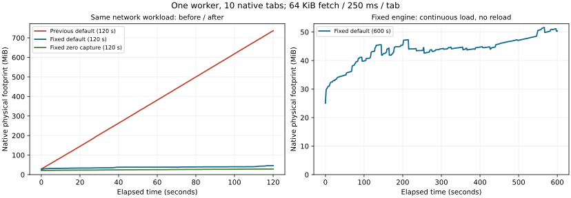

# A1 fetch ve CDP bellek düzeltmesi

**736,25 MiB’a çıkan 120 s ağ koşulu, native düzeltmeyle 46,09 MiB tepeye düştü (%93,7 azalma). 600 s reload’suz yoğun ağ koşulunda tepe 51,56 MiB oldu.** Dört geçerli koşuda toplam 1.900 ilerleme kontrolü geçti; kalan worker sıfır. Küçük footprint artışı tamamen sıfır değildir; aşağıda ayrıca belirtilir.

A2 bu inceleme boyunca bekletildi. Değişiklik yalnız renderless Lightpanda motorunun A1 kaynak ömrüne ve ölçüm araçlarına aittir; JEV entegrasyonu ve insan kontrol yüzeyi eklenmedi.

## Sorunun kanıtı

Önceki [kaynak incelemesinde](A1_RESOURCE_RESULTS.md) aynı profilde 10 sekme, sekme başına 250 ms’de bir 64 KiB fetch ile 120 saniyede native worker tepe belleği **736,25 MiB** oldu. CDP body capture sıfırlanınca bile tepe **417,84 MiB** kaldı. Bu, yalnız cache bütçesini azaltmanın yetmediğini gösteriyordu. Eski ham ölçümler korunur; buradaki karşılaştırma yeni bir motor sürümüdür.

Native regresyon testi 32 fetch’i tamamlayıp gövdelerini okuyor; sayfanın canlı `GlobalTracker` referans sayısının başlangıca dönmesini kontrol ediyor. Eski motorda **beklenen 0, bulunan 32** ile başarısız oldu. `Fetch.init` promise resolver’ı kalıcı V8 handle olarak kaydediyor, fakat success/error/shutdown yolları bunu bırakmıyordu. Yerel handle’a dönüştürmek kalıcı handle’ı serbest bırakmıyor. [V8’in handle/GC sözleşmesi](https://v8.dev/docs/embed#handles-and-garbage-collection) de kalıcı handle’ın açıkça bırakılmasını, yerel handle’ın ise kendi scope’u boyunca yaşamasını tanımlar. Bu kök, tamamlanmış promise/response zincirini sayfa kapanana kadar yaşatabiliyor.

İkinci mekanizma CDP’deydi: yanıt gövdelerinin eski varsayılanı target başına 200.000.000 byte, kaynak başına 20.000.000 byte idi; target’ların ortak worker bütçesi yoktu. Gövde eviction’ı metadata kaydını kaldırmıyordu. POST kopyaları da frame arena içinde tutuluyor, map’ten çıkmaları kopyanın belleğini geri vermiyordu. Bu kayıtlar HTTP cache’inden ayrıdır; `Cache-Control:no-store` debugger capture’ını kapatmaz. [CDP Network.enable](https://chromedevtools.github.io/devtools-protocol/tot/Network/#method-enable) payload buffer’larını tanımlar; bunlar V8 veya bütün süreç RAM limiti değildir.

736 MiB bir açılış sıçraması değildir: eski kesintisiz koşunun yaklaşık 0/30/60/90/120 s footprint örnekleri **29,03 / 204,97 / 381,80 / 559,74 / 736,25 MiB**’dir. En büyük ardışık örnek farkı 6,84 MiB; eğri istek akışıyla düzenli büyür. Aynı koşuda worker sayısı hep 1, thread tepe değeri 16, FD tepe değeri 14 ve native CPU yaklaşık bir çekirdeğin %3,18’idir; süreç/thread çoğalması görülmez. Bu sentetik yükte gövde üretimi yaklaşık 2,5 MiB/s’dir; footprint artışını tek başına wire byte veya yalnız JS heap miktarı diye yorumlamamak gerekir.

## Motor değişikliği

- Fetch success ve error/abort yolları önce yerel resolver handle’ını alır, kalıcı kökü bırakır ve promise’i yerel handle ile sonuçlandırır. Böylece settlement sırasında çalışan microtask’ın sayfayı kapatması çift release üretmez. Pending shutdown da kalıcı kökü bırakır; `.settled` durumu tekrar sonuçlandırmayı önler. İstek kurulumu başarısız olursa edinilmiş kök geri bırakılır.
- JS kodunun hâlâ tuttuğu `Response` geçerliliğini korur. Native test gövdeyi resolver kökü bırakıldıktan sonra ayrıca okur. CacheStorage’ın promise dışı completion yolu korunur.
- POST gövdeleri bağımsız allocation ile sahiplenilir; eviction, Network.disable, hedef kapanışı ve context teardown bunları gerçekten free eder. Kapanan tab worker bütçesini hemen iade eder.
- Response metadata FIFO ile sınırlanır. Metadata’sı düşmüş bir transferin geç body chunk’ı capture edilmez; asıl HTTP isteği devam eder.
- Worker capture sayacı `App` üzerinde tutulur; aynı worker’ın bütün target ve CDP bağlantıları ortak bütçeyi kullanır. Bir target başka target’ın kaydını zorla silmez; kendi eski kayıtlarını düşürüp gerekirse yeni capture’ı atlar. Bu, target’lar arasında adalet garantisi değildir.

| Kapsam | Başlangıç sınırı |
|---|---:|
| Target yanıt gövdeleri toplamı | 1 MiB |
| Tek yanıt capture’ı | 256 KiB |
| Target response metadata sayısı | 128 |
| Target POST kopyası toplamı | 256 KiB |
| Tek POST kopyası / inline POST üst sınırı | 64 KiB |
| Target POST kayıt sayısı | 128 |
| Worker response + POST allocation kapasitesi toplamı | 8 MiB |

Client `Network.enable` ile daha düşük sınır isteyebilir; üst sınırı yükseltemez. `maxPostDataSize:0` sınırsız anlamına gelmez, 64 KiB tavanı kullanır. Capture dışına çıkan içerik için mevcut `getResponseBody`/`getRequestPostData` hata sözleşmesi kullanılır. Büyük yanıtın sayfa tarafından fetch edilmesi bu cache sınırı nedeniyle kesilmez; asıl HTTP response limiti ayrı olarak 16 MiB kalır. Worker bütçesi kapasiteyi sayar; bounded map metadata, allocator overhead, HTTP/V8/DOM bellekleri ve geçici kopyalar bu 8 MiB’a dahil değildir. **Bütün sürecin RAM’ine sert sınır konmuş değildir.**

## Regresyon testleri

Optimize motor entegrasyonu **23/23**, native Debug takımı **302/302** geçti: CDP 267, Session 4, Frame 22, Storage 1, Fetch 5, CacheStorage 3. Yeni testler başarı/hata/abort sonrası kök sayısını, pending fetch sırasında kapanışı, sonradan okunan Response gövdesini, 300 istek sonrası metadata/POST sınırını, 12 gerçek kardeş target ile ortak bütçeyi, client limit clamp’ini ve metadata silindikten sonra gelen body chunk’ını kapsar. Debug allocation/global-slot kontrolleri açıktır.

Önceki toplam 290 native test, CDP/Session/Frame/Storage filtrelerine aitti. Buradaki 302, bu gruplara eklenen dört CDP regresyonu ve ayrıca çalıştırılan Fetch/CacheStorage filtrelerini içerir; 12 yeni test eklendiği anlamına gelmez. Yeni native test sayısı sekizdir.

## Ölçüm protokolü

Aynı fixture, sampler, C probe, worker argümanları, Puppeteer ve lockfile hash’leri eski koşuyla karşılaştırılır. Her koşul yeni native worker ve fixture ile başlar; ölçüm Node’u koşullar arasında yaşar. Bu nedenle önce/sonra RAM ve CPU tabloları yalnız native worker içindir. `caffeinate -i` ile örnekleme boşluğu engellenir; 3 s üstü boşluk veya 5 s üstü süre aşımı kabul edilmez.

Ölçüm öncesi kaydedilen protokol: üç 120 s koşu (default reload/continuous ve zero capture continuous), ardından default capture ile **reload olmadan 600 s** yoğun ağ. Tepe ≤160 MiB, ilk/son 30 s medyan farkı ≤32 MiB, 600 s koşunun son iki 120 s penceresi farkı ≤16 MiB, bütün progress kontrolleri başarılı ve kalan worker sıfır olmalı. Bunlar bu sentetik regresyonun önceden sabitlenmiş guard’larıdır; canlı sitelere ait SLA veya evrensel bellek garantisi değildir. CPU %100 bir mantıksal çekirdektir. Kaynaklar sırayla ölçülür; tek tekrar güven aralığı vermez.

## Sonuçlar

| 120 s koşul | Eski tepe MiB | Yeni tepe MiB | Yeni ilk/son 30 s medyan MiB | Yeni istek | Yeni native CPU % |
|---|---:|---:|---:|---:|---:|
| default-reload | 336.39 | 45.74 | 33.34 / 42.00 | 4728 | 3.79 |
| default-continuous | 736.25 | 46.09 | 33.09 / 40.28 | 4711 | 2.72 |
| zero-capture-continuous | 417.84 | 28.59 | 22.69 / 27.95 | 4779 | 2.31 |

600 s **default-continuous** koşulu: **23,662 istek**, **1478.875 MiB** yanıt gövdesi, **1180** başarılı kontrol. Örneklenen worker tepesi **51.56 MiB**, kernel lifetime tepesi **51.61 MiB**, RSS tepesi **84.64 MiB**. İlk/son 30 s medyanı **32.47 / 50.34 MiB**. Önceki/son 120 s medyanı **44.69 / 48.33 MiB**, fark **3.64 MiB**; önceden kaydedilen 16 MiB guard’ının altında. Eski motorla 600 s aynı yoğun ağ koşulu çalıştırılmadı; eski 120 s sayısı 600 s A/B sonucu gibi sunulmaz.

**Kalan gözlem:** İlk/son pencere farkı sıfır değil. Büyük fetch-root/capture birikimi bu yükte giderildi; bütün motor allocation’larının uzun vadede sınırlı olduğu kanıtlanmadı. Daha küçük artışın allocator/GC high-water davranışı mı, başka bir tutulum mu olduğu allocation profili ve daha uzun kontrollü koşu gerektirir. A1 kaynak takibinde açık kalır; A2’ye bu çalışma içinde geçilmedi.

Her dört koşuda FD tepe değeri 14, thread tepe değeri 15–16; native fiziksel disk read/write delta toplamı 0. Bu, logical I/O veya swap olmadığı anlamına gelmez; sistem swap/CPU/pressure değerleri ham örneklerde kayıtlıdır. 600 s native CPU gözlemi bir çekirdeğin %1.60’i; sistemde başka CPU yoğun işler vardı. CPU farklarından hızlanma sonucu çıkarılmaz. Sunulan ağ yükü 600 s’de yaklaşık 39,44 istek/s; eski kısa sürekli koşu yaklaşık 39,83 istek/s idi. Küçük throughput farkı gizlenmez. Bütün gözlemlerdeki payload boyutu fixture tarafından 64 KiB olarak doğrulandı.

Kabul edilen en büyük örnekleme boşluğu **2794.21 ms**; bütün koşullar 3.000 ms altında. `HeapProfiler.collectGarbage` dört koşuda da **UNAVAILABLE**; zorunlu GC optimizasyonu kullanılmadı.

## Kanıtlar ve yeniden üretim

- [Ham ölçümler, kaynak snapshot’ları ve protokol](../browser/results/a1-memory-fix-2026-10-16/); [bağımsız doğrulama](../browser/results/a1-memory-fix-2026-10-16/verification.json).
- [Native 302/302 manifesti](../browser/results/a1-memory-fix-2026-10-16/native/manifest.json), [eski Fetch kodundaki beklenen başarısızlık](../browser/results/a1-memory-fix-2026-10-16/native/before-root-test.txt), [aynı regresyonun kodu](../browser/results/a1-memory-fix-2026-10-16/native/settled-root-regression.zig.txt), [yeni Fetch testleri](../browser/results/a1-memory-fix-2026-10-16/native/native-fetch.txt).
- [Optimize ürün 23/23 manifesti](../browser/results/a1-memory-fix-2026-10-16/integration/test-manifest.json), [TAP](../browser/results/a1-memory-fix-2026-10-16/integration/test.tap).
- [Dışlanan iki denemenin gerekçeleri](../browser/results/a1-memory-fix-2026-10-16/excluded-runs.json); ham verileri aynı kanıt dizininde korunur. İlki 4.304,74 ms boşluk nedeniyle bütün 120 s batch’i, ikincisi 3.095,32 ms nedeniyle ilk 600 s denemesini dışladı. Aynı örneklerde sistem CPU’su %72,7 / %73,9 idi; bu ilişki tek başına neden ispatı değildir. Başka çalışmalar durdurulmadı; eşikler gevşetilmedi.
- [Doğrulayıcı negatif testleri](../browser/results/a1-memory-fix-2026-10-16/verifier-rejection.json): 5 s gap, 200 MiB tepe ve başarısız progress verilerinin üçü de reddedildi. İlk doğrulayıcının sabit sayım varsayımı hatası [ayrı kayıtla](../browser/results/a1-memory-fix-2026-10-16/verifier-correction.json) düzeltildi: kontrol sonrası 5 s bekleme ve probe çalışırken atlanan timer tick’leri nedeniyle nominal örnek/kontrol sayısı kesin sayı değildir. Düzeltilmiş kontrol gerçek başlangıç/bitiş kapsamasını, bütün ≤3 s örnek aralıklarını ve tab başına ≤10 s progress aralıklarını denetler. Bellek ve örnekleme eşikleri/protokol/ölçüm verileri değiştirilmedi.

Yeni sürüm `1.1.0-agent-a1-memory1+44e378d`; binary SHA-256 `4a4faeb1048f36c53e961b6bfd2cf4612e1bd4ae3c6f568b932ce751db747f40`. Pinli kaynak + birleşik patch temiz ağaçta doğrulandı, aynı kaynak Debug testleri ve ReleaseFast/snapshot derlemesinde kullanıldı. Manifestlerdeki commit alanı çalışmanın başlangıç HEAD’idir; ölçülen değişiklikler source/patch hash’leri ve snapshot’larla ayrıca tanımlanır. Tekrar komutları [browser README](../browser/README.md#a1-memory-regression) içindedir.

## Kapsam sınırı

Bu düzeltme, sayfanın kendi koduyla sınırsız veri biriktirmesini engellemez. V8 heap limiti, native allocation’lar dahil süreç RAM tavanı değildir; OS cgroup/egress/agent yetkileri A2 ve daha sonraki kapasite kabulünde ayrıca ele alınır. Günlerce dayanıklılık, gerçek sitelerin bütün API davranışları ve 60 bağımsız profil / 500.000.000 byte hedefi bu testten çıkarılamaz. Desteklenmeyen `HeapProfiler.collectGarbage` üzerinden GC ölçülmüş veya optimizasyon yapılmış sayılmaz.
