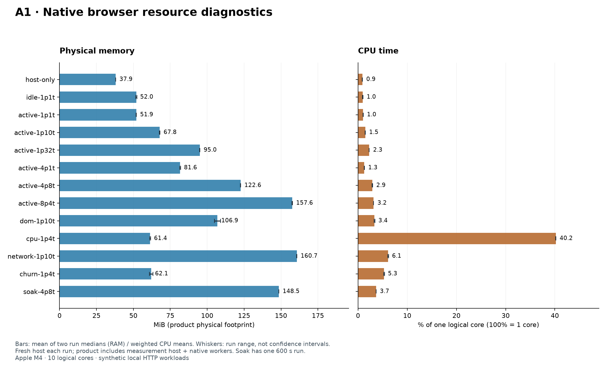
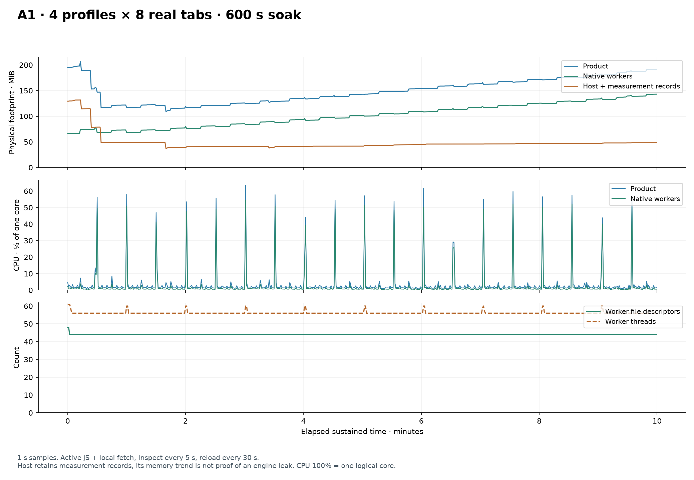
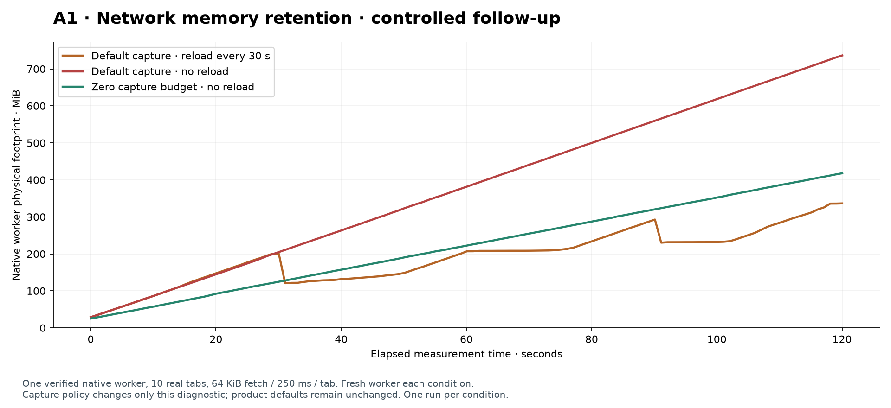

# A1 genişletilmiş kaynak kullanımı incelemesi

## Kaynak sağlığı kararı ve öncelikli bulgular

**İşlev/ilerleme ve kapanış kontrolleri 30/30 ölçüm koşusunda geçti; toplam 6440 kontrol var. Kaynak sağlığı için bellek tutma sorunu açık.** PASS burada içerik/ilerleme, örnekleme guard’ı ve worker temizliğidir; belleğin uzun vadede sınırlı kaldığına dair onay değildir. Motor ve ürün varsayılanları bu incelemede değiştirilmedi.

1. **CDP yanıt gövdesi saklama bütçesi küçültülmeli ve toplamı sınırlandırılmalı.** 32 aktif sekmeli 10 dakika koşusunda native worker ilk/son 60 s medyanı yaklaşık 73 →139 MiB oldu. Node ölçüm sürücüsü bu artışı açıklamaz. Aynı yükü üç ayrı native worker’da 120’şer saniye sınadık: 30 s reload, kesintisiz gezinme ve yalnız tanı için `Network.enable(maxTotalBufferSize:0,maxResourceBufferSize:0)`.
2. **V8 heap sınırı süreç RAM sınırı değildir.** Motordaki CDP target sarmalayıcısında varsayılan gövde saklama bütçesi 200.000.000 byte, tek gövde bütçesi 20.000.000 byte. Bunlar HTTP yanıt boyutu sınırından ve V8’in 64 MiB heap sınırından ayrı native kaynaklardır. Çok sekmede hedef başına bütçelerin toplamı büyüyebilir; yalnız yeniden yüklemeye güvenilemez.
3. **Aynı profilde CPU yoğun sekmeler tek worker’da yarışır.** 16 yoğun sekme tek profilde yaklaşık bir çekirdeği doldururken, dört profil ayrı worker’larda paralel ilerledi. Bu ayrım agent planlaması ve timeout/adalet kararlarını etkiler; ayrı profil daha fazla RAM/thread maliyeti taşır. İzolasyon RAM hedefi için gevşetilmedi.

### Ağ belleği için kontrollü takip

Tek native worker, 10 gerçek sekme, sekme başına 250 ms’de 64 KiB fetch; her koşul yeni worker ve fixture ile başladı. Ana matristeki aynı motor, Puppeteer ve fixture kullanıldı. Tanı Node sürücüsü koşullar arasında yaşar; bu tabloda **yalnız native worker** belleği/CPU’su karşılaştırılır. İlk/son pencereler 30 s’dir. Her koşul bir kez çalıştı; güven aralığı veya evrensel sızıntı oranı değildir.

| Koşul | İlk 30 s RAM medyan MiB | Son 30 s RAM medyan MiB | Örneklenen tepe MiB | HTTP istek | Yanıt gövdesi MiB | Native CPU % |
|---|---:|---:|---:|---:|---:|---:|
| default-reload | 117.33 | 257.00 | 336.39 | 4800 | 298.16 | 3.46 |
| default-continuous | 115.77 | 648.77 | 736.25 | 4780 | 298.75 | 3.18 |
| zero-capture-continuous | 74.25 | 369.38 | 417.84 | 4780 | 298.75 | 2.87 |

Bu deneyde capture bütçesini sıfırlamak native bellek tutulumunun önemli bir bölümünü azaltıyor. Kesintisiz varsayılan ile sıfır bütçe arasındaki son pencere farkı **279.39 MiB**. Bu fark ölçülen ayarın etkisidir; kalan belleğin bütün alt bileşenleri için heap/allocation profili çıkarılmış değildir. Yanıt gövdesi cache’i, allocator/GC davranışı ve request metadata ömrü birlikte ele alınmalıdır. **Sıfır capture koşulu da büyüyorsa, cache bütçesini kısmak tek başına çözüm değildir.** Zero-capture yalnız tanı koşuludur, ürüne kalıcı olarak uygulanmadı; ileride body okuma gereksinimleri için açık ve sınırlı bir politika gerekir.

Kaynak incelemesi: pinli upstream [network buffer varsayılanları](https://github.com/lightpanda-io/browser/blob/44e378d6113d40a6ef1e66ff8b27e1da34ef1647/src/server/cdp/domains/network.zig) ve [capture/eviction mekanizması](https://github.com/lightpanda-io/browser/blob/44e378d6113d40a6ef1e66ff8b27e1da34ef1647/src/server/cdp/CDP.zig). Patch target’lara ait bu durumu ayırır; profil/worker ve tüm ürün için ayrıca toplu kaynak bütçesi gerekir. HTTP `Cache-Control:no-store`, CDP debug capture’ını devre dışı bırakmaz.

### GC gözlemi ve ikinci kök neden adayı

Ölçüm bittikten sonra, sürekli fetch devam ederken explicit GC komutu ayrıca denendi; bu adım steady RAM/CPU dağılımına katılmadı.

| Koşul | GC kontrolü | Motor cevabı |
|---|---|---|
| default-reload | UNAVAILABLE | Protocol error (HeapProfiler.collectGarbage): 'HeapProfiler.collectGarbage' wasn't found |
| default-continuous | UNAVAILABLE | Protocol error (HeapProfiler.collectGarbage): 'HeapProfiler.collectGarbage' wasn't found |
| zero-capture-continuous | UNAVAILABLE | Protocol error (HeapProfiler.collectGarbage): 'HeapProfiler.collectGarbage' wasn't found |

Bu motorda desteklenmeyen GC komutu bir serbest bırakma ölçümü üretmez. Kaynakta ikinci aday: [Fetch.zig](https://github.com/lightpanda-io/browser/blob/44e378d6113d40a6ef1e66ff8b27e1da34ef1647/src/browser/webapi/net/Fetch.zig) promise resolver’ı persist ediyor; tamamlama yolunda yerel resolver’a dönüştürme var, açık release görünmüyor. [PromiseResolver.Global](https://github.com/lightpanda-io/browser/blob/44e378d6113d40a6ef1e66ff8b27e1da34ef1647/src/browser/js/PromiseResolver.zig) release sağlıyor ve [GlobalTracker](https://github.com/lightpanda-io/browser/blob/44e378d6113d40a6ef1e66ff8b27e1da34ef1647/src/browser/js/js.zig) referansları sayfa üzerinde izliyor. Bu, tamamlanmış response/promise zincirinin sayfa ömrünce tutulması için **kaynak temelli güçlü bir adaydır; düzeltme A/B testiyle henüz ispatlanmadı**. Minimal tekrar üretim, success/error/abort/shutdown yolları ve çift-release regresyonlarıyla doğrulanmalı.

### CPU doygunluğu ve gecikme

16 sekmenin her biri 100 ms’de yaklaşık 10 ms hesaplama yapar. 30 s koşuları tek tekrar içerir. Gecikmeler yerel sentetik sayfanın `inspect` çağrılarıdır; bütün komut türleri veya canlı siteler için SLA değildir. CPU %100 bir mantıksal çekirdek, bu makinede %1000 on çekirdeğin zaman toplamıdır.

| Topoloji | Ürün RAM medyan MiB | Native CPU % | Ürün CPU % | Inspect p95 ms | Tab başına sayaç Hz ortalama |
|---|---:|---:|---:|---:|---:|
| cpu-1p16t | 100.38 | 99.73 | 100.26 | 160.39 | 6.24 |
| cpu-4p4t | 178.37 | 158.75 | 159.29 | 10.62 | 9.91 |

Sayaç Hz’i her sekmenin ilk/son bağımsız gözlemi arasındaki artıştan hesaplanır. Tek profildeki yükün istenen 10 Hz’i sağlayamaması, DOM doğru kalırken ilerlemenin yavaşlayabileceğini gösterir. Dört profilde paralellik artar; RAM/CPU bütçesi ve görev adaleti birlikte planlanmalıdır.

### Ölçüm sınırı ve sonraki somut iş

- A1 işlev kabulü ve önceki 290/290 native regresyon kanıtı korunur. Yeni ölçüm **sabit kaynak tüketimi kabulü vermez**. Öncelik, CDP body/request kayıtları için hedef +profil/worker +ürün bütçesi ve yaş/sayı sınırı belirlemek; fetch resolver/reference ömrünü küçük regresyonla doğrulamak ve ardından aynı ağ/soak koşularını yeniden sınamaktır. 500.000.000 byte /60 bağımsız profil hedefi henüz doğrulanmadı.
- Ölçüm host’u örnek/olay/kontrol kayıtlarını RAM’de tutar; Node heap/cache eğrisi saf SDK maliyeti değildir. Native worker ayrıca raporlanır. OS page cache temizlenmedi: yeni süreç, soğuk disk anlamına gelmez. RSS paylaşılan sayfaları tekrar sayabilir; physical footprint toplamı da Linux PSS ölçümü değildir.
- Bu çalışma yerel HTTP ve sentetik yükle sınırlıdır. TLS/gerçek internet, günler süren dayanıklılık, Linux cgroup/PSI, watt/enerji, GPU ve sıcaklık ölçümü yapılmadı. Eksik değerler sıfır kabul edilmez.

Takip koşularının kaynak hash’leri ve binary kimliği ana matrisle [bağımsız doğrulandı](../browser/results/a1-resources-2026-10-16T07-29-23-666Z/followups/verification.json). 134,8 s örnekleme boşluğu olan ilk takip serisi bütünüyle dışlandı ve yeniden çalıştırıldı; reddetme testi `followups/verifier-rejection.json`, dışlama kaydı `followups/excluded-runs.json` içindedir. Yeni tanı araçları `scripts/diagnose-cpu-contention.mjs`, `scripts/diagnose-network-memory.mjs` ve `scripts/verify-resource-followups.mjs` ile tekrar çalıştırılabilir.

Tarih: 2026-10-16. **25/25 deney PASS; 5560 sekme içerik/ilerleme kontrolü; 0 kalan worker.** Mevcut A1 motoru değiştirilmeden RAM, CPU, disk I/O, thread/FD/socket ve host gecikmesi ölçüldü. JEV çalıştırılmadı. Bu A1 tanı deneyidir; A7 kapasite veya güvenlik kabulü değildir.

## Deney düzeni

Makine: Apple M4, 10 mantıksal çekirdek, 16384.00 MiB RAM; darwin/arm64, Node v25.8.2. Her koşu yeni Node host + ayrı fixture süreciyle başladı. 12 senaryo 30’ar saniye iki kez, ikinci seri ters sırayla; ardından 4 profil ×8 sekme 600 s çalıştı. Her koşu 3 s host başlangıç ve 5 s kapanış sonrası gözlem içerir. Fixture ürün toplamından çıkarılır ve ayrıca ölçülür.

Ürün = tek Node host/ölçüm sürücüsü + benzersiz native worker süreçleri. Ham kaynak kayıtları, içerik kontrolleri ve olayları bellekte tutan ölçüm sürücüsünün maliyeti dahildir; host-only referansı bunu görünür kılar. Probe/ps kısa ömürlü yardımcı süreçleri ürün toplamına katılmaz; probe süreleri kaydedilir. Maliyetler tüm makine uygulamalarının RAM/CPU toplamı değildir.

Physical footprint ana RAM metriğidir; RSS ayrı tutulur ve paylaşılan sayfalar nedeniyle aynı anlama gelmez. Örnekleme 1 s: kısa CPU/RAM tepeleri kaçabilir. Native lifetime peak toplamı ayrıca JSON’dadır; süreçlerin farklı anlarda gördükleri tepelerin toplamı eşzamanlı ürün tepesi değildir. CPU native Mach sayaçlarından timebase dönüşümüyle nanosaniyeye çevrilir; gerçek monotonic örnek aralığı kullanılır. **CPU %100 = bir mantıksal çekirdek; bu makinede %1000 = on çekirdeğin zaman toplamı.** E/P çekirdekleri eşit işlem kapasitesi sayılmaz. Makine payı ayrıca JSON’da 10’a bölünmüş olarak vardır. CPU birimi bağımsız Node CPU sayacıyla test edildi; [Apple XNU kaynak davranışı](https://github.com/apple-oss-distributions/xnu/blob/main/osfmk/kern/bsd_kern.c) ve [Mach zaman dönüşümü](https://github.com/apple/darwin-xnu/blob/main/osfmk/mach/mach_time.h) esas alındı.

## Sürekli yük sonuçları

Aralıklar iki bağımsız koşunun medyanlarını/CPU zaman ağırlıklı ortalamalarını gösterir; güven aralığı değildir. RAM tepe ve thread/FD değerleri iki koşunun en yüksek örneğidir. p×t = profil ×profil başına sekme.

| Senaryo | p×t | Tekrar×süre sn | Ürün RAM medyan MiB | Ürün RAM tepe MiB | Worker RAM medyan MiB | Ürün CPU % | Thread tepe | FD tepe |
|---|---|---|---:|---:|---|---|---:|---:|
| host-only | 0×0 | 2×30 | 37.93–37.96 | 38.05 | 0.00–0.00 | 0.85–0.93 | 11 | 18 |
| idle-1p1t | 1×1 | 2×30 | 51.63–52.33 | 81.83 | 9.50–9.53 | 0.91–1.04 | 28 | 32 |
| active-1p1t | 1×1 | 2×30 | 51.87–52.01 | 81.38 | 9.83–9.83 | 1.01–1.06 | 28 | 32 |
| active-1p10t | 1×10 | 2×30 | 67.60–68.05 | 88.62 | 20.70–21.11 | 1.43–1.51 | 28 | 32 |
| active-1p32t | 1×32 | 2×30 | 94.82–95.10 | 114.24 | 47.09–47.16 | 2.28–2.29 | 28 | 32 |
| active-4p1t | 4×1 | 2×30 | 81.34–81.96 | 135.55 | 39.28–39.30 | 1.26–1.30 | 72 | 74 |
| active-4p8t | 4×8 | 2×30 | 122.52–122.65 | 178.12 | 74.41–74.66 | 2.86–3.00 | 73 | 74 |
| active-8p4t | 8×4 | 2×30 | 157.50–157.71 | 205.50 | 108.82–109.01 | 3.15–3.17 | 133 | 130 |
| dom-1p10t | 1×10 | 2×30 | 104.83–109.05 | 118.58 | 58.22–59.00 | 3.25–3.46 | 28 | 32 |
| cpu-1p4t | 1×4 | 2×30 | 61.04–61.68 | 90.02 | 15.78–15.84 | 40.16–40.21 | 28 | 32 |
| network-1p10t | 1×10 | 2×30 | 160.57–160.82 | 250.88 | 110.17–110.70 | 6.04–6.22 | 28 | 33 |
| churn-1p4t | 1×4 | 2×30 | 60.93–63.18 | 83.16 | 13.17–13.24 | 5.22–5.38 | 28 | 32 |
| soak-4p8t | 4×8 | 1×600 | 148.51 | 206.24 | 100.69 | 3.66 | 73 | 74 |

Idle: 200 DOM düğümü, arka plan timer/fetch yok. Active: 200 düğüm, 500 ms sayaç, 15 s/64 KiB fetch, 5 s inspect. DOM: sekme başına 5000 düğüm, 500 ms’de 250 değişiklik. CPU: dört sekmede 100 ms’de yaklaşık 10 ms hesaplama. Network: 10 sekmede 250 ms/64 KiB fetch, sekme başına en fazla 2 pending. Churn: dört kalıcı sekmeye ek olarak en az 2 s arayla 5 aç/gezin/kapat işlemi. Uzun koşuda 30 s reload var; 30 s kısa koşular reload çevrim dayanıklılığını sınamaz. Kontroller her kalıcı sekmenin etiketini ve gerekli sayaç/fetch ilerlemesini doğrular. Duraklamış JS doğru metin bulunsa bile FAIL olur.

Varsayılan host sınırları değiştirilmedi. 1p10t/1p32t ve 8p4t gibi deneyler manifestte kayıtlı tanı kotası yükseltmeleri kullanır. Sekme ve profil maliyeti farklıdır: profil ayrı süreç/native Session taşır. 32 sekme veya 8 profil sonucu 60 bağımsız profil için doğrusal garanti oluşturmaz.

## I/O ve yanıt süreleri

Disk değerleri kernel’in süreç fiziksel I/O sayaçlarıdır; cache’den okuma fiziksel disk okuması sayılmayabilir. Logical write ayrıca gösterilir. Setup/teardown I/O dağılımları ve raw sayaçlar JSON’da ayrı fazlardadır. HTTP byte yalnız fixture yanıt gövdesidir; header, CDP/WebSocket, TLS veya tüm ağ kartı trafiği değildir. Socket/FD sayıları descriptor sayısıdır; benzersiz uzak bağlantı sayısı değildir.

| Koşu | Disk okuma MiB | Disk yazma MiB | Logical yazma MiB | HTTP istek | HTTP gövde MiB | Inspect p95 ms | Event loop p99 dağılım p95 ms | Probe p95 ms |
|---|---:|---:|---:|---:|---:|---:|---:|---:|
| host-only/r1 | 0.13 | 0.00 | 0.00 | 0 | 0.00 | — | 23.61 | 40.92 |
| idle-1p1t/r1 | 0.05 | 0.00 | 0.00 | 0 | 0.00 | 2.98 | 25.80 | 38.85 |
| active-1p1t/r1 | 0.03 | 0.00 | 0.00 | 2 | 0.13 | 1.92 | 27.05 | 42.71 |
| active-1p10t/r1 | 0.06 | 0.00 | 0.00 | 20 | 1.25 | 1.20 | 34.54 | 46.06 |
| active-1p32t/r1 | 0.06 | 0.00 | 0.00 | 64 | 4.00 | 0.50 | 23.72 | 39.19 |
| active-4p1t/r1 | 0.05 | 0.00 | 0.00 | 8 | 0.50 | 3.18 | 23.43 | 38.75 |
| active-4p8t/r1 | 0.03 | 0.00 | 0.00 | 64 | 4.00 | 2.32 | 22.92 | 38.02 |
| active-8p4t/r1 | 0.05 | 0.00 | 0.00 | 64 | 4.00 | 2.95 | 23.71 | 40.19 |
| dom-1p10t/r1 | 0.06 | 0.00 | 0.00 | 20 | 1.25 | 1.54 | 23.72 | 39.12 |
| cpu-1p4t/r1 | 0.05 | 0.00 | 0.00 | 0 | 0.00 | 6.41 | 21.95 | 29.43 |
| network-1p10t/r1 | 0.06 | 0.00 | 0.00 | 1193 | 74.56 | 1.24 | 23.23 | 38.24 |
| churn-1p4t/r1 | 0.14 | 0.00 | 0.00 | 75 | 0.08 | 1.78 | 25.10 | 43.57 |
| churn-1p4t/r2 | 0.09 | 0.00 | 0.00 | 75 | 0.08 | 1.79 | 23.79 | 53.41 |
| network-1p10t/r2 | 0.05 | 0.00 | 0.00 | 1193 | 74.56 | 1.26 | 23.27 | 42.49 |
| cpu-1p4t/r2 | 0.06 | 0.00 | 0.00 | 0 | 0.00 | 8.96 | 21.86 | 29.22 |
| dom-1p10t/r2 | 0.05 | 0.00 | 0.00 | 20 | 1.25 | 2.04 | 22.76 | 39.10 |
| active-8p4t/r2 | 0.06 | 0.00 | 0.00 | 64 | 4.00 | 2.95 | 22.81 | 39.28 |
| active-4p8t/r2 | 0.05 | 0.00 | 0.00 | 64 | 4.00 | 2.00 | 25.59 | 39.15 |
| active-4p1t/r2 | 0.03 | 0.00 | 0.00 | 8 | 0.50 | 5.02 | 24.46 | 39.56 |
| active-1p32t/r2 | 0.08 | 0.00 | 0.00 | 64 | 4.00 | 0.68 | 23.94 | 38.76 |
| active-1p10t/r2 | 0.06 | 0.00 | 0.00 | 20 | 1.25 | 1.47 | 26.74 | 51.54 |
| active-1p1t/r2 | 0.06 | 0.00 | 0.00 | 2 | 0.13 | 2.28 | 22.76 | 41.77 |
| idle-1p1t/r2 | 0.05 | 0.00 | 0.00 | 0 | 0.00 | 2.01 | 22.33 | 46.21 |
| host-only/r2 | 0.00 | 0.00 | 0.00 | 0 | 0.00 | — | 23.30 | 37.00 |
| soak-4p8t/r1 | 0.05 | 0.00 | 0.00 | 1856 | 78.65 | 2.06 | 22.82 | 35.68 |

Probe maliyeti CPU/footprint karşılaştırmalarının yorumunda dikkate alınmalıdır. Event loop ölçümü 20 ms çözünürlüklüdür, saf SDK gecikmesi değildir. Başlatma, newTab, navigate, reload, close ve churn gecikmeleri operations.json/result.json içindedir. Doğum/ölüm arasındaki kısa süreç işlerinin bir kısmı örnekler arasında kaçabilir; özellikle setup/teardown CPU/I/O toplamları tam yaşam döngüsü maliyeti diye sunulmaz.

## Uzun koşu ve kapanış

4×8 aktif tab 600.0 s çalıştı; 3808 doğrulama yapıldı. İlk ve son 60 s medyan worker footprint: **72.77 → 138.99 MiB**. Host/ölçüm sürücüsü: **78.66 → 47.96 MiB**. Worker FD medyanı: **44 → 44**. Bunlar gözlenen değişimdir; iki pencere tek başına bellek sızıntısı ispatlamaz. Ölçüm kayıtlarının büyümesi, GC ve cache host eğrisini etkiler. Native worker eğrisi ayrıca incelenmelidir.

Her senaryoda host kapatıldı, kaydedilmiş worker PID’lerinin sonlandığı doğrulandı ve 5 s yalnız host recovery örnekleri alındı. Tarayıcı kapandıktan sonra aynı Node sürecinin bütün heap/cache belleğini işletim sistemine hemen iade etmesi beklenmez; baseline/recovery farkı tek başına worker sızıntısı sayılmaz.

Sistem genelinde gözlenen en yüksek CPU doluluğu %78.03; swap kullanım aralığı 101.88–1324.75 MiB; pressure seviyeleri 2, 1. Bunlar diğer masaüstü uygulamalarını da içerir; tarayıcıya atfedilmez. Compressor, swap-in/out, pagein/out, fault/context-switch ve wakeup ham sayaçları tutulur. Güç watt, enerji, GPU yükü ve sıcaklık ölçülmedi; sıfır diye raporlanmaz. Linux/cgroup/PSI, gerçek internet/TLS ve günler süren dayanıklılık bu macOS sentetik deneyinin kapsamı dışındadır.

## Tekrar üretim ve kanıt

`cd browser && npm ci --ignore-scripts && npm run engine:build && npm run resources:build && npm test && caffeinate -i npm run measure:resources`. Geniş koşu yaklaşık 25 dakika sürer; `npm run measure:resources -- --smoke` kısa araç kontrolüdür ve bu rapora kabul edilmez. Native kaynak ebdcd3f8bdb61922237d9b1a376d3f3146ca9e625fb554c01bfe7aaeab1972a3 SHA-256 binary ile çalıştı.

Yeni testler: ağaç/union sayımı, CPU zaman birimi ve çekirdek normalizasyonu, PID reuse/counter reset/missing metric ve gerçek native CPU/FD/RAM probu. Tüm entegrasyon takımı **23/23 PASS**. Önceki native 290/290 ve üç 600 s A1 kabul kanıtı [A1 sonuçlarında](A1_RESULTS.md) korunur; motor bu deneyde değiştirilmedi.

- [Manifest](../browser/results/a1-resources-2026-10-16T07-29-23-666Z/manifest.json), [25 koşu özeti](../browser/results/a1-resources-2026-10-16T07-29-23-666Z/results.json), [test makbuzu](../browser/results/a1-resources-2026-10-16T07-29-23-666Z/test-manifest.json).
- Aynı evidence klasöründe her koşunun örnekleri, kontrolleri, operasyonları, olayları ve kullanılan kaynak snapshot’ları bulunur.

## Grafikler

Üç grafik standart matplotlib ile ham kayıtlardan üretildi. Üretici sürümleri ve PNG hash’leri [grafik makbuzundadır](assets/a1-resources-2026-10-16/plots.json). Çalışma kaynağı snapshot’ları ölçüm başlangıcını, `analysis-sources/` ise sonradan kullanılan doğrulama/yorum/grafik araçlarını ayrı kaydeder. Sistem genelindeki CPU/swap değişimleri diğer masaüstü yüklerini de içerir; tarayıcıya atfedilmez ve bu koşu boş bir laboratuvar makinesi iddiası taşımaz.

## Diskte kurulum boyutu

Motor binary’si 87.40 MiB mantıksal dosya boyutunda; profil başına kopyalanmıyor. NPM bağımlılıkları diskte 31.77 MiB, ayrı Node runtime dosyası 0.07 MiB. Ölçüm probu 33.50 KiB. Kaynak/derleme/araç ve grafik ortamını içeren yerel geliştirme cache’i 5.38 GiB; Git’e ve runtime paketine dahil değildir. Ölçümler `installation-footprint.json` içindedir.
