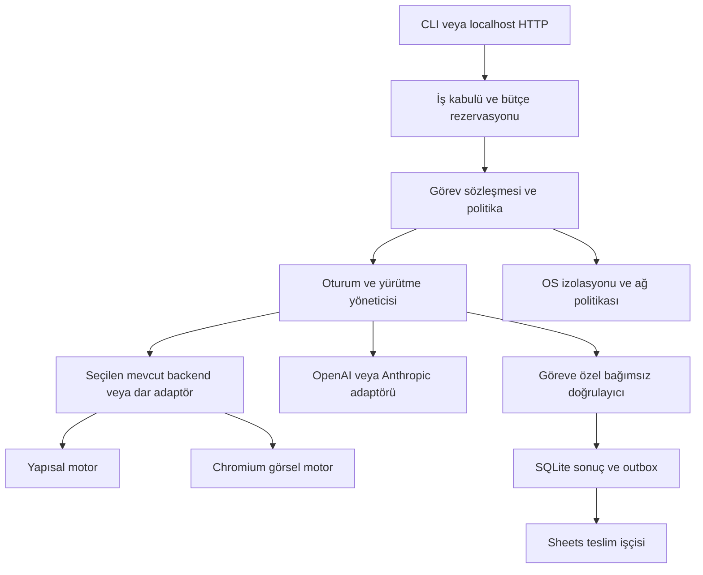

# Agent Browser Runtime — MVP planı

Sürüm: **2.0**. Tarih: **2 Ekim 2026**. Durum: planlama; çalışma zamanı kanıtı yok.

Bu belge v1.0'ı geçersiz kılar. [Görev sözleşmeleri](TASK_CONTRACTS.md) ve [kabul protokolü](ACCEPTANCE.md) normatif eklerdir. İşlem anlamı/durum geçişlerinde görev sözleşmesi, ölçüm/eşiklerde kabul protokolü esas alınır. Çelişki bulunursa test PASS verilmez; belgeler birlikte düzeltilir. [Teknik değerlendirme](TECHNICAL_REVIEW.md) izlenebilirlik kaydıdır; arşiv dosyaları yalnız tarihçedir.

## 1. Ürün amacı ve sınırları

İlk kullanıcı, izin verdiği web akışlarını kendi makinesinde veya tek Linux sunucusunda çalıştıran güvenilir geliştiricidir. Ürünün sınanacak değeri: belirli görevleri mevcut araçlarla en az aynı doğrulukta, ölçülen kaynak sınırı içinde çalıştırmak; işlem kanıtını ve teslim durumunu kaybetmemek. Genel web uyumluluğu, genel amaçlı doğru işlem garantisi ve düşük RAM tek başına ürün değeri sayılmaz.

Nihai hedefler:

1. Sabit destek corpus'unda 60 canlı ve bağımsız ilerleyen yapısal oturum; toplam ürün belleği ≤500.000.000 byte; aynı koşuda görev başarısı, hız ve gecikme eşikleri.
2. OpenAI Responses ve Anthropic Messages üzerinden aynı iş sözleşmesi; gerçek image girdili Chromium görsel yolu.
3. Web sonucu ile Google Sheets tesliminin ayrı doğrulanması; belirsiz işlemin otomatik tekrarlanmaması.
4. Mevcut çözümü kullanma, ince katman ekleme veya dar özel geliştirme kararının karşılaştırmalı kanıta dayanması.

500 MB OS'nin tamamını veya uzaktaki LLM'i kapsamaz; cgroup içindeki bütün ürün süreçlerini, cache'i ve yardımcı servisleri kapsar. 400 MB ikinci optimizasyon hedefidir. Görsel/mixed profil aynı bütçeyi aşarsa hedefin bütün kullanım sınıflarında karşılandığı iddia edilmez.

Varsayımlar: tek işletmeci, yerel CLI/localhost API, uzaktaki model API'si, referans Linux x86_64. macOS geliştirme yapılabilir. Gerçek hedef siteler, açık/kapalı kaynak dağıtım ve API harcama sınırı kullanıcı tercihi olarak henüz kesinleşmemiştir. Eksikler §13'te karar sahibi ve kapısıyla kayıtlıdır; gerçek veri veya izin uydurulmaz.

## 2. Kapsam ve artımlı teslim

| Alan | İlk çalışan kesit G1a | Nihai MVP G3 | Sonraki faz |
|---|---|---|---|
| Görev | Bir doğrulanabilir yapısal görev, tek oturum | R1 kayıt okuma, R2 tanımlı test formu, V1 canvas seçim akışı; sabit destek listesi | Genel internette keyfi görev ve finansal/geri döndürülemez işlemler |
| Backend | P0'da seçilen mevcut yol | Yapısal motor + Chromium görsel yol; mevcut adaptörler kullanılabilir | Yeni browser engine, tam Playwright eşdeğeri |
| Sağlayıcı | Erişim/bütçeye göre bir sağlayıcı | İki sağlayıcıyla sözleşme ve kapasite testleri | Native computer/browser araç seti eşdeğerliği |
| Sonuç | SQLite'ta doğrulanmış sonuç | Aynı sonuçtan OAuth/Sheets kalıcı teslimi | Gmail, tüm Drive, mevcut keyfi dosya düzenleme |
| Görüntü | Kapsam dışı | Screenshot, koordinat click, keyboard, viewport scroll | Drag, gelişmiş pointer ve 60 görsel oturum garantisi |
| Dağıtım | CLI + localhost API, tek işletmeci | Temiz Linux kurulum ve işletim rehberi | SaaS, çok kiracılı servis, dashboard, Kubernetes |
| İstemci | Projenin CLI/HTTP istemcisi | İki programatik model adaptörü | Codex/Claude ürünlerine plugin kurulumu |

Backend olarak MCP kullanmak, son kullanıcıya MCP sunucusu/plugin ürünü teslim etmekle aynı kapsam değildir. Bir bileşeni yeniden kullanmak güvenlik, ölçüm veya test yükümlülüklerini ortadan kaldırmaz. Her kesitin kapsamadığı nihai gereksinimler görünür kalır.

## 3. Önce yeniden kullanım: mimari karar yöntemi

### 3.1 Karşılaştırılacak adaylar

| Aday | Amaç | Zorunlu inceleme |
|---|---|---|
| agent-browser + Chromium | Mevcut araç katmanı için başlangıç baseline'ı | Ref/action semantiği, daemon/session maliyeti, IPC ve modelden kaçış yüzeyleri |
| agent-browser + Lightpanda | Aynı araç yüzeyinde motor farkını ölçme | Layout gerektirmeyen görevlerde doğruluk, destek ve bellek |
| Lightpanda MCP / yerleşik agent | Mevcut yerel araç/agent yüzeyini değerlendirme | Keyfi evaluate/shell/secret araçlarını güvenilir biçimde kapatma; provider ve görev politikası uyumu |
| Chromium + Playwright | Etkileşim doğruluğu referansı ve olası backend | Native protokol ile CDP bağlantısını ayrı etiketleme; bütün daemon maliyeti |
| Dar özel adaptör | Yalnız diğer adayların ölçülmüş açığı | Önce hazır CDP kütüphanesi; custom client son seçenek |

[agent-browser](https://github.com/vercel-labs/agent-browser) Chromium/Lightpanda seçimi ve native daemon sunar. [Lightpanda](https://lightpanda.io/docs/core-concepts/architecture-overview) kendi agent/MCP yollarını sunar. Bunlar P0 adaylarıdır; bu projenin güvenlik veya kapasite testlerini geçmiş sayılmazlar.

Araç katmanı karşılaştırmasında aynı model, prompt, araç şeması, iş corpus'u ve limitler korunur. Yerleşik agent bunu sağlayamıyorsa ayrıca ürün karşılaştırması yapılır; farklı prompt/loop sonucu yalnız motora atfedilmez. Uyumlu adaylarda 1/10/30/60 oturum, aynı izolasyon ve aynı ölçüm sınırı kullanılır. Reddedilen adayın gerekçesi kaydedilir; sessizce tablodan çıkarılmaz.

### 3.2 Karar kuralları

Önce görev doğruluğu, güvenlik ve lisans uygunluğu zorunlu geçer; RAM avantajı bunların yerine geçmez. Yeterli adaylar arasında toplam bellek, başarı başına süre/API maliyeti ve bakım yükü karşılaştırılır. Gürültü içinde kalan farklar mimari üstünlük sayılmaz. Uygun mevcut çözüm varsa ince katman seçilir. Özel adaptör için en küçük başarısız örnek, neden yapılandırma/katmanla giderilemediği ve bakım sahibi ADR'de bulunur. Hedefi hiçbir aday sağlamıyorsa başarısızlık raporlanır; yeni motor yazımı otomatik çözüm değildir.

Go, ince kontrol katmanı gerektiğinde varsayılan **adaydır**. Tek süreç avantajı Go'ya özgü değildir; seçilmiş backend'in ek süreç sayısı ve SDK/GC tamponları toplam ölçülür. Dil değişimi, SDK seçimi veya özel store, yalnız ölçülmüş ihtiyaç ve ADR ile yapılır. İki motor için iki yeni driver yazma zorunluluğu kaldırılmıştır.

### 3.3 Bileşenler

Diyagram mantıksal bileşenleri gösterir; her kutu ayrı süreç değildir. Doğrulayıcı ve teslim işçisi modelden ve sayfadan talimat almaz. Fixture doğrulama sunucusu test altyapısıdır; üretimde gerekli doğrulayıcı istemci, durum ve tamponlar ürün cgroup'una dahildir.

P0'da süreç başına oturum ve backend destekliyorsa paylaşımlı shard ölçülür. Çerez/storage ayrılığı, native çökme etkisi ve OS güvenliği ayrı koşullardır. Shard'da etkilenebilecek azami iş sayısı açıkça kaydedilir. Lightpanda'nın belgelenmiş CDP bağlantı sınırı oturum sayısına eşit varsayılmaz; pinlenen sürümde gerçek topoloji sınanır. [Serve seçenekleri](https://lightpanda.io/docs/reference/cli/serve)

Her adayın capability manifesti target attach/detach, frame lifecycle, RPC correlation, event sırası, navigation, storage, DOM/AX lookup, action ve cancellation kapsamını supported/unsupported/no-op olarak kaydeder. Sayfa kapanırken bekleyen RPC, navigation sırasında frame kaybı ve event sırası K2'de sınanır. Özel CDP yüzeyi seçilirse bu manifest bakım taahhüdünün sınırıdır; tam Playwright eşdeğerliği çıkarılmaz.

## 4. Görev doğruluğu ve araç davranışı

Model doğal dil hedefinden serbest yetki üretmez. İş, güvenilir istemcinin seçtiği sürümlü görev şablonu ile başlar. Şablon; kaynak/hedef, iş nesnesi kimliği, izin verilen alan/değerler, işlem anlamı, doğrulayıcı, zaman/maliyet ve teslim hedefini içerir. Model doğrulayıcıyı, izinleri veya kabul eşiğini değiştiremez. Tam alanlar ve R1/R2/V1 şablonları [TASK_CONTRACTS.md](TASK_CONTRACTS.md) içindedir.

`dom_semantic` ile `rendered_user_input` ayrı işlem profilleridir. İlki tanımlı DOM işlemini, ikincisi render edilen arayüzde görünürlük/örtülme/etkileşim koşullarını taahhüt eder. DOM görüntüsü veya placeholder screenshot, gerçek render sonucu sayılmaz. [Lightpanda mimarisi](https://lightpanda.io/docs/core-concepts/architecture-overview), [Playwright actionability](https://playwright.dev/docs/actionability)

Ortak araç adları yalnız eşdeğer davranış kanıtlandığı ölçüde ortak anlam taşır. Motor seçimi görev kabulünde yapılır. Uygun olmayan motorda hata verilir; işlem semantiği sessizce gevşetilmez. Öngörülmeyen görsel ihtiyaçta yeniden yönlendirme ancak henüz dış yan etki oluşmadığı veya güvenli tekrar kanıtlandığı durumda ayrı deneme olarak yapılır; süre ve maliyet sıfırlanmaz.

Ref doğrulaması düğüm varlığına ek olarak iş nesnesi kimliği ve beklenen sürüm/değerleri kapsar. Aynı düğümün farklı kaydı temsil etmesi, değişen form hedefi, autosave ve Enter ile submit test edilir. Tarayıcı kontrolü ile sunucu commit'i arasındaki yarış genel web için atomik olarak çözülemez: kritik yazma için sunucunun nesne/sürüm/idempotency kontrolü veya eşdeğer doğrulanabilir sözleşme gerekir. Bu yoksa otomatik yazma destek dışıdır.

R1'de başarı, tanımlı kaynağa uygun çıkarımı kanıtlar; bilginin dünyadaki doğruluğunu garanti etmez. R2'de başarı, hedef sistemde doğru nesne/değerlerle tek kaydın oluşmasıdır. V1'de gerçek görsel içerikten doğru hedefin seçilmesi bağımsız fixture durumuyla doğrulanır. Sheets readback yalnız teslim kanıtıdır. Doğrulama yokluğu başarıya çevrilmez.

## 5. Oturum, yürütme ve kalıcı depolama

Oturum, görev yürütmesi ve teslimin ayrı durum makineleri vardır; API üçünü birlikte gösterir. `EXECUTION_VERIFIED`, doğrulanmış sonucu; `DELIVERY_VERIFIED`, hedefe teslimi belirtir. Google teslimli iş ancak ikisi de sağlandığında `COMPLETED` görünür. Web sonucu değişmez; teslim hatası yeni web yürütmesi başlatmaz. Ayrıntılar ve çökme tablosu [görev sözleşmesindedir](TASK_CONTRACTS.md).

Varsayılan store **SQLite**'tır; özel journal kaldırılmıştır. Tek instance dosya kilidi ve tek mantıksal writer; yerel disk; WAL, `synchronous=FULL`, foreign key ve unique kısıtları başlangıç kararıdır. Driver, sınırlı connection/cache ayarları ve gerçek dosya sistemi P0'da pinlenip ölçülür. Ayarlar okunarak doğrulanır. WAL checkpoint ve uzun reader davranışı sınanır; network filesystem kullanılmaz. [SQLite WAL](https://www.sqlite.org/wal.html), [PRAGMA](https://www.sqlite.org/pragma.html)

Mantıksal kayıtlar: `jobs`, `executions`, `action_intents`, `verified_results`, `outbox`, `delivery_attempts`, `resource_reservations`, `schema_migrations`. Unique anahtarlar: istemci idempotency key'i; job + attempt + command; sonuç kimliği; spreadsheet/sheet/row rezervasyonu. Aynı istemci anahtarı/farklı canonical payload hash'i çatışma hatasıdır; aynı anahtar/aynı payload mevcut işi döndürür.

İşin kabulü ile kota/disk/maliyet rezervasyonu tek transaction'dır. Dış yan etkiden önce intent commit edilir. Sonuç doğrulama kaydı, immutable payload ve outbox eklemesi aynı transaction'dadır. SQLite transaction'ı dış servisle atomiklik sağlamaz; kayıp cevapta uzlaştırma gerekir. Process kill, yeniden başlatma, disk-full ve gerçek durability testleri ayrı yürütülür. Yalnız process kill, güç kaybı kanıtı diye sunulmaz.

İptal ve yeniden başlatmada run generation artırılır; önceki generation'a ait geç provider/araç cevapları mutasyon başlatamaz. Gönderilmiş dış işlem iptalle geri alınmış sayılmaz. Belirsiz gönderim `OUTCOME_UNKNOWN` kalır; otomatik yeniden yürütme yoktur. Oturum yeni işe ancak eski in-flight işlemler sonuçlandırılıp izole edildiğinde açılır; gerekirse kapatılır.

### 5.1 Sınırlı kuyruk ve disk

Aşağıdaki değerler başlangıç konfigürasyonudur; P0 ölçümünde değişiklik gerekirse gerekçe/manifest kaydıyla, kabul koşusu başlamadan güncellenir. Byte birimleri onluktur.

| Kaynak | Varsayılan sınır ve davranış |
|---|---|
| Aktif yürütme | 60; ayrıca model concurrency sınırı; fazla iş gizli sınırsız kuyruğa alınmaz |
| RAM teslim tamponu | 20 sonuç veya 1.000.000 byte; geri kalan kayıtlar SQLite'ta, keyfi prefetch yok |
| Sonuç payload'u | İş başına ≤100.000 byte; kabulde azami boyut için rezervasyon |
| Kalıcı pending + kabul edilmiş rezervasyon | ≤1.000 iş ve ≤100.000.000 payload byte; ilk dolan sınır uygulanır |
| Yerel çalışma alanı | DB/WAL, sonuç, kanıt, log ve temp dahil 1.000.000.000 byte yönetilen bütçe; en az 200.000.000 byte kurtarma payı ve yeterli filesystem boşluğu |
| Yüksek/düşük eşik | Pending kapasitesinin %80'inde veya kurtarma payı tehlikedeyse yeni iş reddi; %60 altı ve disk sağlıklıysa yeniden kabul |
| Kanıt ve log | Screenshot opt-in, varsayılan 24 saat ve 100.000.000 byte; log rotasyonu ≤50.000.000 byte; tamamlanmış kayıt varsayılan 7 gün |

Hesaplara payload yanında ölçülen DB/index/WAL büyümesi katılır; yalnız ham JSON boyutuyla disk garantisi verilmez. İki eşik transaction altında eşzamanlı kontrol edilir. Fiziksel yer yetmiyorsa yan etki başlatılmaz. Kabul edilmiş işlerin sonucu için ayrılan pay korunur; pending/unknown kayıtlar TTL veya log rotasyonuyla silinmez. Sonuç boyutu şemada sınırlıdır; sessiz truncation yoktur. Beklenmeyen disk hatasında yeni mutasyonlar durur, sağlık durumu bozulur ve belirsiz intent'ler restartta uzlaştırılır.

Pending kotası yalnız durum adı PENDING olanları değil, henüz teslimi çözülmemiş IN_FLIGHT/UNKNOWN/BLOCKED/CONFLICT kayıtlarını da kapsar. Operatörün teslimi durdurması kotayı veya veriyi sessizce serbest bırakmaz. Dedupe tombstone'ları, tamamlanmış kayıtlar ve retention maliyeti de fiziksel çalışma alanı hesabındadır; zorunlu retention bütçeye sığmıyorsa yeni iş kabulü durur.

Uzun Google kesintisinde outbox saklanır, admission baskı uygular. Disk dolana kadar sonsuz üretim yoktur. Teslim circuit breaker'ı durumu ve sonraki deneme zamanını gösterir. Operatör kontrollü export/resolve vardır; pending kaydı silmek veya görevi yeniden çalıştırmak otomatik kurtarma değildir.

## 6. Model adaptörleri ve sınırlar

OpenAI Responses ve Anthropic Messages aynı iç görev/araç sözleşmesine ayrı adaptörlerle bağlanır. Seçilen dilin resmi SDK'sı önceliklidir; Go seçilirse resmi Go SDK'ları. Snapshot model kimliği, API/SDK sürümü, prompt/şema hash'i kaydedilir. Sabit model sürümü sunulamıyorsa bu sınırlama raporlanır; alias değişimi yeni değerlendirme gerektirir. [OpenAI function calling](https://developers.openai.com/api/docs/guides/function-calling), [Claude tool use](https://platform.claude.com/docs/en/agents-and-tools/tool-use/overview)

Küçük ayrı araç şemaları, sunucu doğrulaması, call-id/tool-use-id eşlemesi gerekir. Destekleyen OpenAI profillerinde strict required/nullable ve additionalProperties kuralları uygulanır. Parallel çağrı sağlayıcıda kapatılır; beklenmedik çoğul çağrılar executor tarafından güvenli sıraya alınır veya reddedilir. Strict destek model yeteneğidir; P0 smoke testinde doğrulanır.

Retry'nin sahibi controller'dır; SDK retry kapatılır veya tek toplam bütçeye sayılır. Timeout, iptal, HTTP body limiti, pool, 429/5xx ve maliyet testi zorunludur. Tamamlanmamış stream argümanıyla mutasyon yapılmaz. Geçmiş tam assistant + tool-result gruplarıyla korunur; gerekli reasoning/thinking/protokol blokları rastgele kesilmez. Provider state/response kimliği job ve generation'a bağlıdır.

İlk kesitte otomatik özetleme/compaction yazılmaz. Şema ve gözlem boyutları sınırlanır; protokolü bozmadan history bütçesine erişildiğinde kontrollü duruş yapılır. Gerekli görev bu sınırda tamamlanamıyorsa P0/G1 başarısızlığıdır; sessiz context kesme yoktur. Compaction ancak ölçülmüş ihtiyaç ve ayrı doğruluk testiyle eklenebilir. Gerçek image blokları, viewport/crop/scale ve piksel sınırı korunur.

İş başına en çok 30 model/araç turu; geçerli teklifin controller'a ulaştığı t0'dan itibaren toplam başarı süresi 180 saniye: admission/browser/model/doğrulama bölümü en çok 150, kalan süre teslim için. Bekleme/429 ve yeniden deneme süreye dahildir; kullanıcı müdahalesi bu SLA'yı uzatmaz. Başarı deadline'ı bitse de in-flight etkinin uzlaştırılması sürer; geç sonuç ayrı işaretlenir. Tam ölçüm tanımları [ACCEPTANCE.md](ACCEPTANCE.md) içindedir.

Model concurrency ile browser session sayısı ayrı ölçülür. Her çağrı öncesi azami output ve birikmiş context maliyetiyle bütçe rezervasyonu yapılır; tüm in-flight rezervasyonlar toplam hesaba katılır. Kullanım raporu sonradan gelse de bütçe aşımına açık sınırsız paralellik yoktur. Hesap fiyat/limitleri ve nakit test tavanı P0 girdisidir; bütçe yoksa canlı çağrı yoktur.

## 7. Google OAuth ve Sheets teslimi

Kapsam yalnız uygulamanın oluşturduğu sonuç dosyasıdır. `drive.file` ilk izin adayıdır; Sheets scope'u satır yetkisi sağlamaz, satır politikası controller'dadır. Google token'ı modele veya browser worker'a verilmez. [Sheets izinleri](https://developers.google.com/workspace/sheets/api/scopes)

Desktop OAuth client: yerel auth CLI → sistem tarayıcısı → random-port 127.0.0.1 callback; tek kullanımlık state, S256 PKCE, kısa callback süresi. Desktop secret güvenilir gizli anahtar sayılmaz. Headless Linux'a operatörün auth CLI'sinden controller-only secret mount/import yapılır; credential transferi log/stdout'a düşmez. Remote web OAuth UI sonraki fazdır. [Desktop OAuth](https://developers.google.com/identity/protocols/oauth2/native-app)

Öncelik OS secret store; dosya vault gerekirse standart kütüphaneyle authenticated encryption, benzersiz nonce ve ayrı master key kullanılır. Şifreli dosya tek başına, aynı erişim yetkisindeki saldırgana karşı ek sınır sayılmaz. Anahtar repo/browser ortamından ayrıdır; plaintext fallback yoktur. İzin, sürümleme, atomik overwrite, import/export, refresh, revoke ve anahtar yokluğu test edilir. Yerel DB token deposu değildir.

External/Testing koşullarında ilgili izinlerle refresh token ömrü için 7 günlük sınırlama ele alınır; hesap modu kaydedilir. Mock expiry, canlı refresh/revoke ve gerçek 8. gün canary ayrı sonuçlardır. Canary planlandı diye PASS verilmez; uygulanabilir hesap modunda G3 kanıtıdır. access_denied, invalid_grant, callback uyuşmazlığı ve admin policy hataları mock veya erişilebilir gerçek hesap testinde açık etiketlenir. [OAuth koşulları](https://developers.google.com/identity/protocols/oauth2)

Tek writer, yalnız `EXECUTION_VERIFIED` sonuçların outbox kayıtlarını işler. Başlangıç flush eşiği 2 saniye veya 20 sonuçtur; boyut ayrıca en çok 1.000.000 byte. RAW değerler; sabit kolon/sonuç şeması; okunabilir alan uzunlukları ve canonical payload hash'i. Kullanıcı/proje okuma-yazma kotaları ayrı bucket; başka istemciler için pay, jitter/backoff ve deadline. 60/dakika kullanıcı ve 300/dakika proje kotaları kabul edilirken gerçek hesap durumu yeniden kontrol edilir; verification okumaları dahildir. [Sheets limitleri](https://developers.google.com/workspace/sheets/api/limits)

Row allocation ve job/payload/hash ilişkisi gönderimden önce SQLite transaction'ıyla kalıcıdır. Writer aynı row'a aynı payload'u tekrar yazabilir; belirsiz cevapta önce okur. Kayıt aynıysa teslim doğrulanır; boşsa aynı rezervasyonla yazılır; farklıysa `DELIVERY_CONFLICT` ve dosya teslimi durur. Hash sütununa kör güvenilmez: dönen hücre değerlerinden canonical payload yeniden hesaplanır ve beklenen job/nesne kimliğiyle karşılaştırılır. Hash gizli veri veya saldırgana karşı imza değildir.

Sheet create cevabı kaybolursa dosya kimliği kesinleşene kadar `DELIVERY_UNKNOWN`; kör create/append yoktur. Operatör mevcut dosyayı uzlaştırır. Uygulama tek yazıcıdır; manuel satır ekleme/silme/taşıma/sıralama destek dışıdır. Eşzamanlı insan yazmasına atomik compare-and-write garantisi verilmez. Gerekirse görüntüleme ayrı rapor/tab üzerinden yapılır; sahip kullanıcının değiştirebilmesi teknik olarak engellenmiş sayılmaz.

Deadline sonrası teslim `DELIVERY_BLOCKED` olur; kayıt korunur. Yeniden deneme açık `delivery retry` komutuyla, aynı payload/row için yeni sınırlı teslim bütçesiyle yapılır; web görevi çalışmaz. Geç uzlaştırılan teslim audit'te korunur fakat geçmiş SLA başarısızlığı düzeltilmez.

## 8. Güvenlik ve işletim

Güven sınırı: güvenilir işletmeci/şablon, güvenilmeyen web içeriği ve model önerisi. Tek işletmeci seçimi saldırgan sayfa riskini kaldırmaz. Tehdit hedefi; worker'dan host/diğer session/secret erişimini ve sözleşme dışı yan etkiyi engellemektir. Genel prompt injection çözümü iddia edilmez.

Yerel API erişim anahtarıyla, dar body/süre sınırlarıyla çalışır; localhost bağlamak tek başına yetkilendirme değildir. Origin/Host kontrolleri, CORS kapalı varsayılanı ve DNS rebinding testleri vardır. Debug/CDP portları yalnız controller'ın eriştiği namespace/socket sınırındadır. Auth ve ölçüm endpoint'leri dahil internet yayını yoktur.

Worker ayrı unprivileged kimlik, dosya/temp kotaları ve uygulanabilir OS sandbox içinde çalışır. Native engine compromise tehdidi için namespace/seccomp/capability sınırları P0'da test edilir; sadece cookie izolasyonu güvenlik sınırı sayılmaz. Güvenliği kapatarak RAM geçişi yapılamaz.

Tüm engine trafiği denetlenen egress yolundan geçer; direct bypass OS düzeyinde kapalıdır. Redirect, DNS yeniden çözümü/rebinding, IPv4/IPv6 alternatifleri, subresource/fetch/iframe/WebSocket ve desteklenen worker/protokoller sınanır. Desteklenmeyen WebRTC/QUIC/service-worker gibi kaçış yüzeyleri devre dışı bırakılır veya kontrolü kanıtlanır. Test fixture ağı için sınırlı ayrı allowlist bulunur. Controller provider/Google/verifier bağlantıları ayrı yetkilidir.

Domain allowlist'i işlem yetkisi yerine geçmez. Bir şablon HTTP method/path/body sınırı gerektiriyorsa, TLS içeriğini görmeyen CONNECT proxy bunu sağlıyor sayılmaz. Gerekli kontrol engine interception veya gerçekten doğrulanmış başka bir katmanda uygulanmalı; uygulanamıyorsa ilgili yazma görevi reddedilmelidir. Site script'lerinin kendiliğinden oluşturduğu istekler de kontrol kapsamındadır.

Yeniden kullanılan backend'in shell/evaluate/eklenti/custom-argument/secret araçları modelden erişilemez. Shell string birleştirme yerine doğrulanmış argv/structured IPC kullanılır. Model yalnız controller araçlarını görür; alternatif porttan sınırsız backend'e erişemez. Güvenlik kontrolü uygulanamayan aday elenir.

Model/provider/Google anahtarları, cookie ve auth form değerleri log, DB evidence veya model observation içine sızmaz. Görev için gerekli normal alanlar ayrı allowlist ile modele aktarılır; password/secret ref doğrudan controller tarafından çözülür. Screenshot'ta hassas alan varsa kayıt/aktarım politikası uygulanır; gizliliği sağlanamayan akış desteklenmez.

CAPTCHA/2FA `NEEDS_INPUT` üretir. Yalnız sözleşmede tarif edilmiş operator-assisted akışta, aynı session doğrulanıp yeni generation ile `job resume` yapılabilir; timer sıfırlanmaz. Genel insan tarayıcısı devralma arayüzü vaat edilmez. Destekli resume yoksa iş durur; bypass yapılmaz.

DB migration öncesi destekli tutarlı yedek, schema sürümü ve geri dönüş yöntemi gerekir. WAL dosyasını dışarıda bırakan ham kopya yedek sayılmaz. Secret'lar yedekten ayrı yönetilir. Dependency/SBOM/lisans listesi, sürüm pinleme, temiz kurulum ve yükseltme geri alma testi G3 teslimidir. Worker/pending/unknown kayıtları operatöre görünürdür.

## 9. Ölçüm ve kabul stratejisi

Normatif protokol [ACCEPTANCE.md](ACCEPTANCE.md) içindedir. Aynı koşuda RAM, görev başarısı, tamamlanan iş hızı, cezalı p95, yan etki doğruluğu ve teslim birikmesi birlikte değerlendirilir. Ayrı tek-session eval sonucu, yük altındaki başarı koşulunun yerine geçmez. Araç işlemi başarısı yalnız yardımcı metriktir.

Referans: Linux x86_64, cgroup v2, 4 vCPU, en az 8 GB host RAM, swap kapalı. Cgroup'a controller, bütün backend/engine çocukları, SDK/history, verifier, store/cache/WAL belleği, proxy, screenshot tamponları ve teslim işçisi dahildir. Fixture/load harness dışarıdadır. Harness'e üretim işi kaydırılmaz. Cold/warm cache durumu ve harici shared-page sahipliği raporlanır; karşılaştırmalar aynı koşuldadır.

P0 erken ölçüm için taban, ek oturum, eşzamanlı payload ve restart maliyetlerini ayırır. Ölçülen kısım + kanıtlı üst tahminli eksik entegrasyon payı + geçici tepe payı 500 MB'a sığmıyorsa G0 geçmez. Eksik bileşen maliyeti sıfır kabul edilmez; hesap nihai kanıt değildir. G2 entegre tepeyi startup ve recovery dahil ölçer. `memory.current/peak/events`, swap, PSS/RSS, CPU, fd, progress ve maliyetler kaydedilir. [cgroup v2](https://docs.kernel.org/admin-guide/cgroup-v2.html)

## 10. İş paketleri ve karar kapıları

P0 için önerilen toplam **8 geliştirici günü araştırma zaman sınırıdır**; tüm hipotezleri çözme garantisi değildir. Süre bittiğinde eksik kanıtla rapor verilir; sessiz uzatma veya zorunlu geçiş yoktur. 6–9 haftalık önceki toplam tahmin iptal edilmiştir. Sonraki paketlerin aktif çalışma aralığı ve dış bağımlılıkları G0'da ölçülen yeniden kullanım oranına göre tahmin edilir; G1b'de tekrar kalibre edilir.

| Paket | Somut teslim | Önkoşul ve çıkış |
|---|---|---|
| P0a / en çok 2 gün | Ürün/görev şablonları, 20 görev corpus taslağı, doğrulayıcı tasarımları, gerçek site/izin ve bütçe matrisi | Güvenilir girdi eksikleri kayıtlı; fixture-only araştırma gerçek site onayı yerine geçmez |
| P0b / en çok 2 gün | Mevcut backend karşılaştırması, capability/semantik manifesti, lisans dağıtım incelemesi | Zorunlu yetki/doğruluk özelliklerini sağlayan aday veya gerekçeli eleme |
| P0c / en çok 3 gün | Seçilen adayda 1/10/30/60 erken RAM, egress/isolation, SQLite/SDK/payload/restart spike | Ham metrik, tekrar edilebilir komutlar, başarısız örnekler, headroom hesabı |
| P0d / en çok 1 gün | ADR, dondurulmuş corpus/manifest, eksik kanıt, yeniden tahmin ve devam kararı | G0; teknik başarısızlık/harici blokaj ayrılır |
| P1 / G1a | Tek görev + tek backend + tek sağlayıcı; policy/verifier; SQLite intent/result/outbox; CLI durum/iptal | K1–K8'in ilgili çekirdeği; yerel sonuç %100 fixture doğruluğu; dış yazma varsa güvenli recovery |
| P2 / G1b | Google auth/vault ve kalıcı teslim; resume/reconcile/delivery retry; temiz tek-session E2E | K9–K11; timeout/Google hatası web görevi tekrarı üretmez |
| P3 / G1c | İkinci sağlayıcı, Chromium gerçek görüntü, kalan görev şablonları | İki modelin T14-eval'i; görsel işlem ve capability doğruluğu |
| P4 / G2 | Entegre 60-session replay/live, mixed, chaos/churn, kabul raporu | Bütün uygulanabilir K testleri; tüm birleşik eşikler aynı koşuda |
| P5 / G3 | Kurulum/yükseltme/backup, destek matrisi, gerçek site canary, hesap-modu OAuth kanıtı | Eksiksiz beta raporu; açık zorunlu kapı varsa beta kabulü yok |

P1'den itibaren her yeni bileşen 1/10-session kaynak kontrolünden geçer; 60 ölçümü P4'e kadar ertelenmez. Ham CDP prototipi ürünleştirilecekse ayrı maliyet kalemi açılır. P0 prototipinin atılabilir olması beklenen araştırma maliyetidir.

| Kapı | Zorunlu kanıt | Eksik/olumsuz sonuç |
|---|---|---|
| G0 | Görev ve güvenilir verifier tasarımı; gerçek corpus için izin/girdi; backend kararı; lisans uyumu; OS/egress proof; 60 erken ölçüm ve headroom; API erişim/bütçe | FAIL, BLOCKED_EXTERNAL veya RESEARCH_ONLY; koşulsuz ürün geliştirme geçişi yok |
| G1a | Dar kesitin iş nesnesi/policy doğruluğu, yerel kalıcı sonuç ve generation/cancel | Eksik provider veya fixture-only durum final kabul sayılmaz |
| G1b | Tek sağlayıcıdan bağımsız web kanıtı + gerçek Sheets readback; recovery/disk/kota | Teslim verisi başarı kanıtı yerine geçmez |
| G1c | İki sağlayıcı, görsel yol, tüm 20 görevin eval'i | Eksik motor/model için kapsam açık |
| G2 | A-runtime + iki A-live + B-visual/B-mixed; K1–K17 uygulanabilir testler | Yapısal ve görsel sonuç ayrı; başarısız 500 MB koşulu revizyon olmadan PASS yapılamaz |
| G3 | G2, gerçek site destek kanıtı, kurulabilir paket ve işletim/OAuth kanıtı | Zorunlu NOT_RUN/BLOCKED sonucu kalırsa nihai MVP kabulü açık |

Karar raporları PASS/FAIL/NOT_RUN/BLOCKED_EXTERNAL kullanır. RESEARCH_ONLY yalnız eksik ürün girdileriyle yerel teknik araştırmanın sürdüğünü belirtir, G0 PASS değildir. Hedef/kapsam değişikliği kullanıcı kararıdır; yeni manifest ve yeni ölçüm gerekir. Teknik implementasyon ayrıntıları yetkilendirilmiş kapsam içinde uygulayıcı kararıdır.

## 11. Teslim yapısı ve CI

Uygulama başladığında mantıksal modüller: `controller`, `contracts`, `policy`, `sessions`, `backends`, `providers`, `verifiers`, `store`, `delivery`, `observability`. Dil/dizin ayrıntıları ADR'de seçilir; şimdiden Go dizin ağacı dayatılmaz. Browser motorları/vendor kodu yeniden yazılmaz.

Her değişiklikte ilgili şema/durum/idempotency testleri ve 1/10-session fixture conformance; engine/model/SDK güncellemesinde capability, action semantiği ve izolasyon regresyonu; release adayında sabit Linux'ta yük, chaos, canlı eval ve temiz kurulum. Secret ve bütçe gerektiren işler ayrı manuel CI job'udur; PR testleri gerçek API/Google mutasyonu yapmaz.

Teslimler: çalışan seçilmiş backend katmanı, CLI/API, iki provider yolu, verifier şablonları, SQLite migration ve recovery, Google connector, test fixtures, run manifest, JSON/CSV ham metrikler, başarısız örnekler, destek matrisi ve işletim rehberi. Sadece kullanılan backend'ler paketlenir. Ürün sürümü, kaynak commit'i, artifact SHA256, tool/corpus/policy/model hash'leri raporda bulunur.

## 12. Kalan riskler ve karar seçenekleri

| Risk | Kabul edilmeden gereken kanıt | Başarısızlıkta seçenek |
|---|---|---|
| 60/500 MB + kalite aynı anda sağlanamıyor | G2 birleşik ölçüm | Backend değişimi, açık bütçe/kapsam önerisi veya durma |
| Mevcut araçların katmanla kontrol edilememesi | K2/K5/K12, dar başarısız örnek | Başka backend; yalnız gerekli dar adaptör |
| Gerçek sitelerde doğrulanamayan yan etki | Göreve özel authoritative receipt/precondition | Yazma desteğini verme; kullanıcıya açık read-only kapsam önerisi |
| Render gereksinimi yüksek, mixed maliyeti büyük | Corpus'a göre motor oranı ve mixed profil | Hedefi karşılamadı raporu; sessiz Lightpanda seçimi yok |
| Shard çökmesi / native açık | Isolation, sandbox ve blast-radius raporu | Daha küçük izolasyon birimi; bellek yeniden ölçümü |
| Provider kota/maliyet/kalite | Hesaba özgü P0 erişim ve G2 live | BLOCKED_EXTERNAL veya ölçülen kalite FAIL |
| Google uzun kesinti / DB dolması | Outbox, admission, recovery testleri | Yeni iş kabulünü durdur, sonucu koru |
| Lisans veya dağıtım uyuşmazlığı | Pinlenmiş artifact/lisans ve gerçek dağıtım değerlendirmesi | Yeniden kullanım/backend/dağıtım seçimini değiştir |
| Takvim belirsizliği | G0/G1b ölçülmüş yeniden tahmin | Kapsam sıralama veya araştırmayı durdurma kararı |

## 13. Açık girdiler, yetki ve güncel kanıt durumu

| Girdi | Karar sahibi | Şimdi uygulanacak davranış | Kapanması gereken kapı |
|---|---|---|---|
| En az 5 hedef akış, 3 domain, site kullanım/işlem izni | Kullanıcı + uygulayıcı | Fixtures ile araştırma; gerçek site desteği ilan edilmez | G0 ürün geçişi / G3 canary |
| Açık/kapalı kaynak ve dağıtım şekli | Kullanıcı | Yerel araştırma varsayımı; lisans uygunluğu sonucu verilmez | G0 |
| Linux referans makine ve OS izolasyon yetkisi | Kullanıcı/ortam + uygulayıcı | macOS sonucu referans RAM kanıtı olmaz | G0 ölçümü |
| API modellerine erişim ve toplam test harcama tavanı | Kullanıcı; uygulayıcı hesaplar | Mock/yerel test; harcama olmadan canlı erişim varsayılmaz | G0 live feasibility / G2 |
| Google test hesabı/client ve dosya sahipliği | Kullanıcı; uygulayıcı kurar | OAuth/delivery testleri mock, gerçekleri NOT_RUN | G1b / G3 |

Bu revizyonun yetkisi plan belgelerini güncellemektir. Runtime uygulaması, kurulum, ücretli API çağrısı, Google hesap bağlama ve yayın bu çalışmada başlatılmaz. Sonraki uygulama yetkisi verildiğinde rutin teknik adımlar tekrar tekrar onaya bağlanmaz; eksik harcama/scope/hesap kararı yalnız ilgili işi sınırlar.

Bugünkü durum: doküman tasarımı revize edildi. G0–G3, K1–K17 ve benchmark profilleri **NOT_RUN**. Birincil kaynaklar yetenek araştırmasıdır; bu projeye ait kapasite, güvenlik veya gerçek site kanıtı değildir. [SOURCES.md](SOURCES.md) ve [TECHNICAL_REVIEW.md](TECHNICAL_REVIEW.md) bu ayrımı korur.
