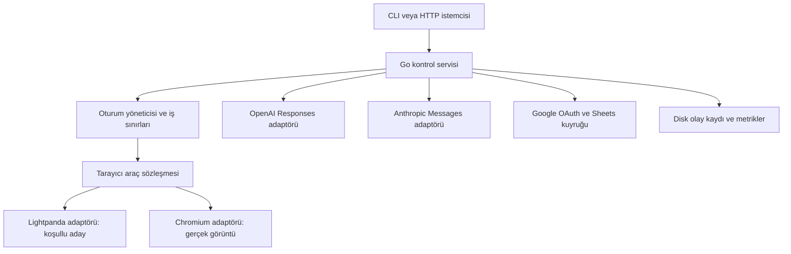

# Agent Browser Runtime — MVP planı

Sürüm: 0.1 — ilk taslak, teknik değerlendirme öncesi. Tarih: 2 Ekim 2026.

Durum: planlama. Uygulama, kurulum ve entegrasyon başlangıcı kullanıcı onayını bekler. `agent-browser-runtime` çalışma adıdır.

## 1. Ürün tanımı ve varsayımlar

Geliştiricilerin GPT veya Claude ile web görevleri çalıştırabileceği, oturumları ayrı tutan ve kaynak tüketimini ölçülebilir biçimde azaltan yerel/self-hosted tarayıcı servisi.

Temel hedef: desteklenen yapısal web görevlerinde 60 canlı ve ilerleyen oturum, bütün ürün servisleri toplamında en fazla 500 MB tepe bellek; 400 MB ikinci optimizasyon hedefi. Ekran görüntüsü gereken işler ayrıca gerçek motorla desteklenir ve bellekleri sayılır. Her sitede bu bütçe taahhüt edilmez.

Plan varsayımları: ilk kullanıcı geliştiricidir; model uzaktaki API'de çalışır; ilk dağıtım tek Linux makinesi ve tek güvenilir işletmecidir; geliştirme macOS'ta yapılabilir. Hedef müşteri, desteklenecek gerçek siteler, açık/kapalı kaynak dağıtım ve API test harcaması ürün kararları olarak onayda netleşir. Bu varsayımlar önceki isteğin kesinleşmiş tercihleri değildir.

İlk gösterim: ürün listesini oku → belirli ürünü seç → test formunu doldur → sonucu doğrula → uygulamanın oluşturduğu Google Sheets dosyasına kaydet. Aynı iş sözleşmesi iki model sağlayıcısında da çalışır.

## 2. MVP kapsamı

| Alan | İlk sürüm | Sonraki sürüme kalan |
|---|---|---|
| Tarayıcı | Yapısal okuma, gezinme, öğe referansıyla etkileşim | Her siteyle tam uyumluluk, browser extension |
| Oturum | Oluşturma, kapatma, iptal, süre sınırı, ayrı çerez/depolama | Son kullanıcının günlük Chrome profilini kullanma |
| Gözlem | Kompakt ağaç, kapsamlı okuma, değişiklik çıktısı | Ham HTML'i sürekli modele gönderme |
| Görsel işler | Chromium'da gerçek screenshot ve temel koordinat işlemleri | 60 görsel oturum için 500 MB garantisi |
| Modeller | OpenAI Responses ve Anthropic Messages client tools | Sağlayıcıların tüm native computer/browser toolset yüzeyini taklit etme |
| Google | OAuth ile uygulamanın oluşturduğu Sheets dosyasına sonuç yazma | Gmail, tüm Drive tarama, Google hesabı parolasıyla browser login |
| Dağıtım | CLI + localhost HTTP; tek makine | SaaS, faturalama, dashboard, Kubernetes |
| Dayanıklılık | Hata sınıfları, kaynak sınırları, kontrollü yeniden başlatma | Canlı JS heap'ini motorlar arasında taşıma |

## 3. Mimari ve teknik kararlar

| Karar | Gerekçe | Kanıt/yeniden değerlendirme |
|---|---|---|
| Yeni browser engine yazma; Lightpanda'yı değerlendir | İlk risk uyumluluk ve bellek; motor geliştirme MVP'yi büyütür | P0 capability ve lisans kapısı |
| Tek Go kontrol servisi | 60 ayrı agent SDK süreci yerine sınırlı ortak yürütme | Go belleği toplam ölçüme dahil; GC limitleri garanti değildir |
| Sınırlı CDP araç adaptörü | Gereken küçük işlem yüzeyini açık tutar | Chromium ve Lightpanda için aynı conformance testleri |
| Playwright test ve referans aracı | Test doğruluğunu üretim driver'ından bağımsız kontrol eder | CDP bağlantısı tam Playwright eşdeğeri sayılmaz |
| Başlangıçta motor seçimi | Canlı sayfa durumunu motorlar arasında taşıma varsayımını kaldırır | Gerektiğinde güvenli görev başından yeniden çalıştırma |
| Tek işletmecili MVP | Kaynak hedefini internetten çok kiracılı servis riskinden ayırır | Dış erişim ve farklı müşteriler için ayrı güvenlik tasarımı |
| Disk kayıtları; sınırlı RAM kuyrukları | Geçmiş ve screenshot biriktirmez | I/O, disk boyutu ve sıralama testleri |

Lightpanda'nın gerçek görüntü/layout sınırları vardır; ayrı Chromium yolu gerekir. [Mimari](https://lightpanda.io/docs/core-concepts/architecture-overview). Lightpanda lisansı AGPL-3.0-only olarak listelenir; dağıtım modeli P0'da değerlendirilir. [Lisans](https://github.com/lightpanda-io/browser/blob/main/LICENSING.md). Ayrı süreç kullanmak tek başına kapalı kaynak lisans sonucunu belirlemez.

Lightpanda varsayılan CDP bağlantı sınırı 16'dır. P0'da gerçek bağlantı ihtiyacı ve 60 oturum topolojisi sınanır; bağlantı sayısı oturum sayısıyla eşit kabul edilmez. [CLI](https://lightpanda.io/docs/reference/cli/serve). Playwright CDP bağlantısı daha düşük kapsamlıdır. [Playwright](https://playwright.dev/docs/api/class-browsertype#browser-type-connect-over-cdp).

P0'da süreç başına bir oturum ile çok oturumlu süreç seçenekleri ölçülür. Çerez ayrılığı, süreç çökmesinin etkisi ve toplam bellek birlikte karşılaştırılır; ölçümden önce topoloji sabitlenmez. Untrusted web içeriklerine karşı OS sandbox ve ağ sınırları yine gerekir. Güvenlik kontrolleri RAM kazanmak için kapatılmaz.

## 4. Araç ve oturum sözleşmesi

HTTP/CLI yönetim yüzeyi: session create/close/cancel, job start/status, health, metrics. Agent'a yalnızca o işe ait session yetkisi verilir.

| Agent aracı | Girdi/çıktı | Davranış |
|---|---|---|
| `navigate` | URL → durum ve observation version | URL/ağ politikası; redirects kontrolü |
| `observe` | scope, cursor → öğe ağacı/değişiklik | Kesilme ve kapsam açıkça bildirilir |
| `find` | role, text → öğe referansları | Birden çok eşleşme gizlenmez |
| `act` | ref, operation, value → sonuç | click, fill, select, press; beklenen durum kontrolü |
| `wait` | koşul, timeout → gözlem | Sabit sleep yerine belirli koşul |
| `screenshot` | viewport/region → gerçek görüntü | Yalnız uygun motor; placeholder başarı sayılmaz |
| `pointer` | koordinat, operation → durum | Yalnız gerçek render motorunda |
| `finish` | sonuç → tamamlanma | Sonuç doğrulama sonrası |

Normal gözlem alanları: `session_id`, `observation_version`, `url`, `capabilities`, `nodes`, `cursor`, `truncated`. Düğümlerde role/name/value/state/ref bulunur. İşlem observation version ve command id taşır. Aynı session'da mutasyonlar sıralanır; oturumlar paralel ilerler. Eski ref, kaybolan öğe veya belirsiz eşleşme tekrar gözlem gerektiren hata üretir.

Hata kodları: `UNSUPPORTED_CAPABILITY`, `STALE_OBSERVATION`, `AMBIGUOUS_ELEMENT`, `NAVIGATION_TIMEOUT`, `POLICY_DENIED`, `RESOURCE_LIMIT`, `SESSION_LOST`, `PROVIDER_LIMIT`, `OUTCOME_UNKNOWN`. Agent aracı keyfi shell/JavaScript çalıştırma yetkisi sunmaz; adaptör içindeki kontrollü JS ayrı uygulanır.

Yazma ve gönderme işlemleri kör biçimde tekrar edilmez. Yeniden deneme öncesi sonucun oluşup oluşmadığı doğrulanır; belirsiz durumda `OUTCOME_UNKNOWN`. Dış sistemde tam exactly-once garantisi iddia edilmez. Oturum yaşam döngüsü: CREATED → READY → RUNNING → COMPLETED/FAILED/CANCELLED → CLOSED; ihtiyaç halinde NEEDS_INPUT durumu.

## 5. Model ve Google entegrasyonları

### Model adaptörleri

Her sağlayıcı aynı iç araç sözleşmesini kendi function/client tool formatına çevirir. OpenAI Responses call id ve Anthropic tool-use id eşleşmeleri korunur. Modelin isteği sunucuda doğrulanır; ham sayfa metni talimat yetkisi kazanmaz. OpenAI/Claude native computer-use şemaları ilk sürümde zorunlu değildir; ürün iki sağlayıcıyla kendi browser araçları üzerinden çalışır.

Önce kayıtlı/mock cevaplarla tool loop, çoklu çağrı, bozuk JSON, bilinmeyen araç, timeout ve iptal testleri. Sonra gerçek API ile küçük smoke/eval koşusu. Model kimliği ve API sürümü konfigürasyonda kaydedilir; değişken alias ile sessiz güncelleme yapılmaz. Erişim, rate limit ve fiyat P0'da hesabın gerçek durumu üzerinden doğrulanır.

İş başına 30 tool turn, 180 saniye ve ayrıca konfigüre edilen token/harcama sınırı. Global API concurrency ölçüme göre ayarlanır; 60 aktif browser session ile 60 eşzamanlı model isteği ayrı metriklerdir. Tool yanıtı ve conversation geçmişi boyut sınırlıdır; özetleme görev sonucunu doğrulamak yerine kullanılmaz. Görsel çıktı iki sağlayıcının kendi image formatına çevrilir.

### Google Sheets

Google hesabı bağlantısı resmi OAuth akışıyla yapılır. Önerilen ilk izin `drive.file`; kapsam uygulamanın oluşturduğu Sheet ile sınırlandırılır. İlk işlem yeni bir sonuç dosyası oluşturmak ve `job_id`, kaynak URL, çıktı, doğrulama durumu, zaman alanlarını yazmaktır. Drive'ın tamamını listeleme veya Gmail okumaya ihtiyaç yoktur.

Yetkilendirme akışı: test Google Cloud projesi → Sheets API → OAuth client/consent/test user → sistem tarayıcısında kullanıcı girişi → loopback callback → token saklama → Sheet oluşturma → aralık yazma ve okuma ile doğrulama → bağlantı kaldırma.

Refresh token ayrı secret store'da saklanır; kaynak kodu/log/model context'ine girmez. `state` doğrulaması, callback sınırı, expiry, refresh hatası ve revoke davranışı test edilir. OAuth uygulama tipine uygun PKCE gerekliliği P0'da doğrulanır. Test modunun kullanıcı/refresh token sınırlamaları üretim koşulları olarak değerlendirilir.

Sheets yazmaları küçük batch'lerle, kota farkındalığıyla ve sınırlı kuyrukla yapılır. `job_id` sabit satır/iş kaydıyla eşleştirilir; belirsiz ağ hatasında kör append yapılmaz. Tek işletmecinin kontrol ettiği dosyada tekrar yazma ile tekrar satır oluşması ayrı test edilir. Kullanıcı düzenlemeleri nedeniyle uyuşmazlık görünür hata üretir. Üretim yayınından önce OAuth kapsam ve doğrulama koşulları yeniden kontrol edilir.

## 6. Bellek ve performans ölçümü

**Birim:** 500 MB = 500.000.000 byte; 400 MB = 400.000.000 byte. MiB ile karıştırılmaz. Hedef tüm OS'nin veya uzaktaki LLM'in belleği değildir; çalışan ürünün cgroup sınırı içindeki bütün bileşenleridir.

Referans ortam: Linux x86_64, cgroup v2, 4 vCPU, en az 8 GB host RAM; OS/kernel/CPU/engine/driver sürümü raporda. macOS sayıları referans sonucu yerine geçmez. Swap kapalı; remote engine, disk swap veya ölçüm sırasında session unload ile maliyet gizlenmez.

Sayılacak bileşenler: Go controller, browser süreçleri ve tüm çocukları, model adaptörleri/transport/geçmiş, Google connector/kuyruk, screenshot encode/buffer, disk cache'in cgroup'a yüklenen kısmı ve log writer. Fixture sunucusu ve yük/ölçüm harness'i test altyapısı olarak dışarıdadır; üretim servisinin hiçbir parçası dışarı taşınmaz.

Birincil `memory.current`, `memory.peak`, `memory.events`, swap; yardımcı PSS/RSS, JS heap, CPU, file descriptors ve session ilerlemesi. [Linux cgroup](https://docs.kernel.org/admin-guide/cgroup-v2.html). İlk koşu sınırsız ölçüm; sonra 500 MB limit altında stres. Limit koymak tek başına optimizasyon kanıtı değildir.

Profil A: 60 yapısal session, 60 dakika, her session periyodik DOM/JS değişikliği ve navigate/read/act/wait döngüsü. Bekleyen model cevabı session'ı kapatmaz. 60 açık boş sekme başarı sayılmaz. Profil B: gerçek screenshot isteyen küçük havuz; kendi kapasite ve tepe bellek sonucu. Profil C: ağır SPA/canvas uyumluluk araştırması; desteklenenler ayrıca kaydedilir.

Önerilen ilk bellek bütçesi ölçüm öncesi tahmindir: controller+provider 70 MB, 60 light session 330 MB, ortak tampon/cache/Google/log 50 MB, geçici tepe payı 50 MB. Her bölüm ölçümle revize edilir; oturum başına 5,5 MB garanti değildir. Profil B için aynı bütçeye sığma varsayımı yoktur.

Gözlem optimizasyonu: sınırlı scope, delta/cursor, cevap boyut sınırı, diskte sınırlı kayıt. Ağ optimizasyonu göreve göre görsel/video/izleyici engelleme; gerekli JS/API/CSS korunur. Bellek taşmaları session düzeyinde görünür hata oluşturur; ürün sessizce kapasite düşürmez.

## 7. Test matrisi ve önerilen kabul eşikleri

| ID | Test | Kabul |
|---|---|---|
| T01 | Araç JSON şeması ve capability | İki model adaptörü ve iki engine için destek/hata semantiği doğru |
| T02 | Basit form/liste/navigasyon | Deterministik fixture'ların %100'ü geçer |
| T03 | Dinamik JS, fetch, SPA rota, iframe, shadow DOM | Destek matrisi P0'da açık; destekli zorunlu vakalar geçer |
| T04 | Ref eskimesi/delta kesilmesi | Yanlış öğeye mutasyon yok; yeniden gözlem |
| T05 | 60 session çerez/storage/ref ayrılığı | Sıfır cross-session veri/işlem karışması |
| T06 | Screenshot/canvas | Gerçek render; sadece metin görünümü tam screenshot diye sunulmaz |
| T07 | Sağlayıcı protokolü | Call id, image, hata, streaming iptal, 429/5xx senaryoları geçer |
| T08 | Google OAuth ve Sheets | Create/write/read/revoke; token sızıntısı ve tekrarlı satır yok |
| T09 | 1/10/30/60 oturum yükü | Aynı görevle throughput ve p95 gecikme raporu |
| T10 | Profil A soak | 60 dakika; 60 ilerleyen session; peak ≤500 MB; beklenmeyen OOM/crash yok |
| T11 | 1.000 session create/close churn | Süreç/fd/sürekli bellek artışı yok; kapanış sonrası taban ölçümü |
| T12 | Crash/network/provider chaos | Controller canlı; etkilenen session görünür FAILED/NEEDS_INPUT; diğer işler ilerler |
| T13 | Prompt injection, URL/ağ politikası | Yetkisiz araç/secret/destination erişimi yok |
| T14 | E2E iki model eval | Aynı 20 görev × sağlayıcı başına 3 tekrar; her sağlayıcı ≥%90 doğrulanmış başarı |
| T15 | Paket/temiz ortam | Kurulum, sürüm manifesti, sağlık kontrolü ve örnek iş dokümantasyonla tekrarlanır |

T14'te modelin söylediği başarı yerine fixture/veritabanı/sheet son durumu oracle olarak okunur. İlk eval'ler kontrollü test domainlerinde; gerçek siteler ayrı canary suite olarak raporlanır. Timeout, unsupported, retry, fallback ve kısmi başarı paydadan çıkarılmaz. Replay ile RAM testi ve canlı LLM testi farklı sonuçlar olarak etiketlenir.

İlk gecikme hedefleri: yerel fixture'da observation p95 ≤250 ms, action p95 ≤500 ms; network/model zamanı ayrı. Bunlar ürün kabul önerisidir, bugün ölçülmüş sonuç değildir. 60 session'da her session en az 10 saniyede bir doğrulanmış işlem/gözlem ilerlemesi üretir; tek tek sırayla çalıştırma paralellik diye raporlanmaz.

## 8. Uygulama iş paketleri ve karar kapıları

Süreler bir geliştirici için tahmini aktif çalışma günüdür; OAuth dış onayları, engine düzeltmeleri ve erişim beklemeleri dahil değildir.

| Paket | İşler ve teslim | Önkoşul | Tahmin / çıkış |
|---|---|---|---|
| P0 | Engine/CDP/isolation spike; 60-session erken RAM testi; lisans ve model/OAuth kontrolü; sürüm pinleme | Kullanıcı onayı | 3–5 gün; devam/dur raporu |
| P1 | Araç şemaları; Go controller; CLI/HTTP; timeout/cancel; session lifecycle; capability | P0 olumlu | 3–4 gün; T01–T05 çekirdeği |
| P2 | Lightpanda+Chromium adaptörleri; observe/ref/delta; network policy; screenshot | P1 | 4–6 gün; destek matrisi ve T02–T06 |
| P3 | OpenAI ve Anthropic tool loop; bounded history; provider error/cost telemetry | P1; P2 test motoru | 3–4 gün; T07 ve ilk E2E |
| P4 | Google test proje kurulum adımları; OAuth/token; Sheet ve dedupe | P1; dış erişim hazır | 2–3 gün; T08 |
| P5 | Bellek profilleme; process topology; cleanup/cache/tampon; overload/chaos | P2–P4 | 4–6 gün; T09–T13 |
| P6 | Live eval/canary; tekrar soak; temiz Linux paket; kullanıcı demo ve kanıt dosyası | P5 | 3–4 gün; T14–T15 ve release kararı |

Toplam 22–32 geliştirici günü + 4–6 gün belirsizlik payı. P0 olumsuzsa sonraki paketlere otomatik geçilmez. İlk teknik hedef P0, ardından çalışır tek-session vertical slice; 60-session optimizasyonu yalnız sonda keşfedilmez.

G0: Lightpanda destek/lisans ve 60-session bütçesi yeterli mi? Olumsuzsa uyumluluk/motor/ürün hedefi değişikliği ölçümle önerilir; kullanıcı hedefi sessizce değiştirilmez. G1: tek-session iki sağlayıcı + doğrulanmış Sheets sonucu. G2: 60-session bellek, dayanıklılık ve kalite. G3: belgelenmiş beta.

## 9. Güvenlik, işletim ve hata yönetimi

API localhost ve yerel erişim anahtarıyla; browser debug portları internetten erişilmez. URL scheme/domain/IP/redirect politikası ve özel ağ koruması adaptörlerin altında uygulanır. Test fixture ağı için ayrı açık allowlist kullanılır. Subresource/fetch/WebSocket yönlendirmeleri de politika kapsamındadır. Kaynak yüklemesi ve response boyutu sınırlanır; gizli servis anahtarları browser environment'ına verilmez.

Başarı hedefi web içeriği güvenilir olmasa da yetkileri host politikasıyla sınırlamaktır; prompt injection'ın tamamen çözüldüğü iddia edilmez. Form gönderme ve Google yazma hedefleri iş konfigürasyonuyla önceden belirlenir. CAPTCHA/2FA/hesap kilidi NEEDS_INPUT üretir; aşma işlemi MVP kapsamı değildir.

Loglar metadata ağırlıklı; form değeri, cookie, token ve gereksiz sayfa içeriği maskelenir. Screenshot sadece gerekli testlerde ve kısa saklama süresiyle. Queue/response/history için üst limitler; log rotasyonu ve disk hata davranışı. Secret'lar kaydedilmez, repo dışında tutulur; Google ve model testleri ayrı hesap/test dosyalarıyla.

Worker restart geçerli checkpoint'ten yalnız tekrar yürütmesi güvenli adımları başlatır. Çöken session'ın tüm canlı durumunun geri geleceği vaat edilmez. Health/readiness, açık işler, hata türü, memory/CPU, model token/harcama ve Google kota metrikleri raporlanır. Sürüm güncellemesi önce conformance ve smoke suite'den geçer.

## 10. Risk kaydı

| Risk | Olasılık/etki | Karşılık |
|---|---|---|
| 60 iş için 500 MB aşılması | Yüksek/yüksek | P0 ölçümü; tüm bileşenler sayılır; hedef değişirse kullanıcı kararı |
| Lightpanda Web API eksikleri | Yüksek/yüksek | Capability matrisi; destek sınırı ve önceden motor seçimi |
| Lisans/ürün dağıtım uyuşmazlığı | Belirsiz/yüksek | P0 dağıtım/lisans değerlendirmesi; alternatif engine/backend yolu |
| Çerez ayrılığı ile crash/security ayrılığını karıştırma | Orta/yüksek | Oturum/process/OS düzeyleri ayrı test |
| Model çıktı farkları ve hız sınırlamaları | Yüksek/orta | Mock + live contract, bounded retries, ayrı concurrency ölçümü |
| Google test/üretim OAuth farkı | Orta/orta | Test mode koşulları, revoke/refresh; üretim kontrol listesi |
| Google write duplicate/yanlış sonuç | Orta/yüksek | job_id, verify-before-retry, final state oracle |
| 60 bağlantının engine'ı zorlaması | Orta/yüksek | CDP session/topology spike; bağlantı limitleri ve test |
| Observation kısaltmanın bilgi kaybetmesi | Orta/yüksek | Cursor/truncated, yeniden okuma; eval ve hata sınıfları |

## 11. Teslim ve onay sınırı

Şimdi teslim: proje klasörü, ilk taslak, bir teknik değerlendirme ve revize plan. Bu işlem API çağrısı yapan ürün kurmaz, gerçek Google hesabı bağlamaz veya yeni remote GitHub repository oluşturmaz.

Onay sonrası ilk paket P0'dır. API/OAuth kimlik bilgileri repo dışında sağlanır; gerçek API testleri için harcama üst sınırı belirlenir. P0 sonuçlarıyla engine/topology ve test domainleri sabitlenir. Scope, bellek iddiası veya dağıtım modeli değişmesi gerekiyorsa ölçülebilir seçeneklerle yeniden ürün kararı alınır.

Uygulama tamamlandığında beklenen dosyalar: çalışan CLI/API; iki engine adaptörü; iki provider adaptörü; Google connector; fixture/conformance/eval/soak testleri; tam sürüm manifesti; JSON/CSV ölçümler; kurulum ve destek matrisi; hata/secret işletim rehberi.

## 12. Kaynak ve kanıt durumu

Resmi dokümanlar ve vendor ölçümleri araştırma girdisidir; bu projeye ait P0 veya 60-session test sonuçları henüz yoktur. [Lightpanda benchmark](https://lightpanda.io/docs/core-concepts/benchmarks) proje kabul testi yerine kullanılmaz. Model/Google entegrasyon kaynakları final sürümün SOURCES.md dosyasında listelenir.
