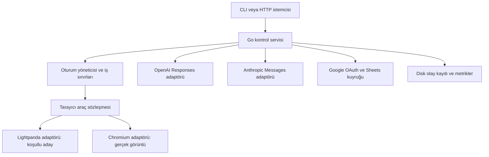

# Agent Browser Runtime — MVP planı

Sürüm: 1.0 — bir teknik değerlendirme turu sonrası revize plan. Tarih: 2 Ekim 2026.

Durum: planlama. Uygulama, kurulum ve entegrasyon başlangıcı kullanıcı onayını bekler. `agent-browser-runtime` çalışma adıdır.

## 1. Ürün tanımı ve varsayımlar

Geliştiricilerin GPT veya Claude ile web görevleri çalıştırabileceği, oturumları ayrı tutan ve kaynak tüketimini ölçülebilir biçimde azaltan yerel/self-hosted tarayıcı servisi.

Temel hedef: desteklenen yapısal web görevlerinde 60 canlı ve ilerleyen oturum, bütün ürün servisleri toplamında en fazla 500 MB tepe bellek; 400 MB ikinci optimizasyon hedefi. Ekran görüntüsü gereken işler gerçek motorla desteklenir ve bellekleri sayılır. Yapısal ve görsel/mixed kabul ayrı raporlanır. Görsel profil 500 MB'ı aşarsa kullanıcının hedefi bütün kullanım sınıflarında karşılanmış sayılmaz; kapasite/scope değişikliği ürün kararı gerektirir.

Plan varsayımları: ilk kullanıcı geliştiricidir; model uzaktaki API'de çalışır; ilk dağıtım tek Linux makinesi ve tek güvenilir işletmecidir; geliştirme macOS'ta yapılabilir. Hedef müşteri, desteklenecek gerçek siteler, açık/kapalı kaynak dağıtım ve API test harcaması ürün kararları olarak onayda netleşir. Bu varsayımlar önceki isteğin kesinleşmiş tercihleri değildir.

İlk gösterim: ürün listesini oku → belirli ürünü seç → test formunu doldur → sonucu doğrula → uygulamanın oluşturduğu Google Sheets dosyasına kaydet. Aynı iş sözleşmesi iki model sağlayıcısında da çalışır. İkinci zorunlu gösterim: canvas üzerinde görünen bilgiyi gerçek screenshot'tan oku → koordinatla hedefe tıkla → bağımsız son durum kontrolü.

## 2. MVP kapsamı

| Alan | İlk sürüm | Sonraki sürüme kalan |
|---|---|---|
| Tarayıcı | Yapısal okuma, gezinme, öğe referansıyla etkileşim | Her siteyle tam uyumluluk, browser extension |
| Oturum | Oluşturma, kapatma, iptal, süre sınırı, ayrı çerez/depolama | Son kullanıcının günlük Chrome profilini kullanma |
| Gözlem | Kompakt ağaç, kapsamlı okuma, değişiklik çıktısı | Ham HTML'i sürekli modele gönderme |
| Görsel işler | Chromium'da screenshot, koordinat click, keyboard input ve viewport scroll | Drag, gelişmiş pointer ve 60 görsel oturum için 500 MB garantisi |
| Modeller | OpenAI Responses ve Anthropic Messages client tools | Sağlayıcıların tüm native computer/browser toolset yüzeyini taklit etme |
| İstemci entegrasyonu | Kendi CLI/HTTP istemcisi ve iki programatik model adaptörü | Claude/Codex ürünlerine MCP stdio/plugin kurulumu; native toolset parity |
| Google | OAuth ile uygulamanın oluşturduğu Sheets dosyasına sonuç yazma | Gmail, tüm Drive tarama, Google hesabı parolasıyla browser login |
| Dağıtım | CLI + localhost HTTP; tek makine | SaaS, faturalama, dashboard, Kubernetes |
| Dayanıklılık | Hata sınıfları, kaynak sınırları, kontrollü yeniden başlatma | Canlı JS heap'ini motorlar arasında taşıma |

## 3. Mimari ve teknik kararlar

| Karar | Gerekçe | Kanıt/yeniden değerlendirme |
|---|---|---|
| Yeni browser engine yazma; Lightpanda'yı değerlendir | İlk risk uyumluluk ve bellek; motor geliştirme MVP'yi büyütür | P0 capability ve lisans kapısı |
| Tek Go kontrol servisi ve resmi Go provider SDK'ları | 60 ayrı agent SDK süreci yerine sınırlı ortak yürütme | SDK/GC/buffer maliyeti toplam ölçüme dahil; P0 transport testi |
| Sınırlı CDP araç adaptörü | Gereken küçük işlem yüzeyini açık tutar | Chromium ve Lightpanda için aynı conformance testleri |
| Playwright test ve referans aracı | Test doğruluğunu üretim driver'ından bağımsız kontrol eder | CDP bağlantısı tam Playwright eşdeğeri sayılmaz |
| Başlangıçta motor seçimi | Canlı sayfa durumunu motorlar arasında taşıma varsayımını kaldırır | Gerektiğinde güvenli görev başından yeniden çalıştırma |
| Tek işletmecili MVP | Kaynak hedefini internetten çok kiracılı servis riskinden ayırır | Dış erişim ve farklı müşteriler için ayrı güvenlik tasarımı |
| Tek yazıcılı disk journal + checkpoint; sınırlı RAM kuyrukları | İş/Sheets kaydı crash öncesi kalıcı olur; geçmiş RAM'de birikmez | Fsync, atomic checkpoint, bozuk son kayıt ve yeniden başlatma testleri |

Lightpanda'nın gerçek görüntü/layout sınırları vardır; ayrı Chromium yolu gerekir. [Mimari](https://lightpanda.io/docs/core-concepts/architecture-overview). Lightpanda lisansı AGPL-3.0-only olarak listelenir; dağıtım modeli P0'da değerlendirilir. [Lisans](https://github.com/lightpanda-io/browser/blob/main/LICENSING.md). Ayrı süreç kullanmak tek başına kapalı kaynak lisans sonucunu belirlemez.

Lightpanda varsayılan CDP bağlantı sınırı 16'dır. P0'da gerçek bağlantı ihtiyacı ve 60 oturum topolojisi sınanır; bağlantı sayısı oturum sayısıyla eşit kabul edilmez. [CLI](https://lightpanda.io/docs/reference/cli/serve). Playwright CDP bağlantısı daha düşük kapsamlıdır. [Playwright](https://playwright.dev/docs/api/class-browsertype#browser-type-connect-over-cdp).

P0'da süreç başına bir oturum ile çok oturumlu süreç seçenekleri ölçülür. Çerez ayrılığı, süreç çökmesinin etkisi ve toplam bellek birlikte karşılaştırılır; ölçümden önce topoloji sabitlenmez. İlk tercih session başına süreçtir. Alternatif shard topolojisi gerekirse en fazla kaç session'ın aynı worker çökmesinden etkileneceği kapasite raporunda ve ürün onayında belirtilir; tek native süreç 60 iş için hata izolasyonu sayılmaz. Untrusted web içeriklerine karşı OS sandbox ve ağ sınırları gerekir. Güvenlik kontrolleri RAM kazanmak için kapatılmaz.

CDP bir Playwright ikamesi vaadi değildir. P0 teslimi command/event manifestini içerir: target attach/detach, frame lifecycle, RPC correlation, event sırası, navigation, DOM lookup/action, storage ve cancellation. Her command için supported/unsupported/no-op ayrımı test edilir. Auto-wait ve locator davranışı gereken küçük yüzeyde tarafımızdan uygulanır. Go CDP kütüphanesi kullanma veya dar client yazma tercihi bu manifest, bakım maliyeti ve ölçümlerle ADR'ye bağlanır.

## 4. Araç ve oturum sözleşmesi

HTTP/CLI yönetim yüzeyi: session create/close/cancel, job start/status, health, metrics. Agent'a yalnızca o işe ait session yetkisi verilir.

| Agent aracı | Girdi/çıktı | Davranış |
|---|---|---|
| `navigate` | URL → durum ve observation version | URL/ağ politikası; redirects kontrolü |
| `observe` | scope, cursor → öğe ağacı/değişiklik | Kesilme ve kapsam açıkça bildirilir |
| `find` | role, text → öğe referansları | Birden çok eşleşme gizlenmez |
| `click` | ref, observation version → sonuç | Hedef/action-time doğrulaması |
| `fill` | ref, text → sonuç | Alan türü ve beklenen değer kontrolü |
| `select_option` | ref, option value → sonuç | Native select desteği; custom dropdown ayrı click akışı |
| `press_key` | ref, key → sonuç | İzinli keyboard işlemleri |
| `wait` | koşul, timeout → gözlem | Sabit sleep yerine belirli koşul |
| `screenshot` | viewport/region → gerçek görüntü | Yalnız uygun motor; placeholder başarı sayılmaz |
| `pointer_click` / `scroll` | screenshot version + koordinat / yön → durum | Yalnız gerçek render; crop/scale koordinat dönüşümü testli |
| `finish` | önerilen sonuç → doğrulama isteği | Başarı beyanı controller oracle kontrolünden geçer |

Normal gözlem alanları: `session_id`, `observation_version`, `document_epoch`, `observation_kind`, `url`, `capabilities`, `nodes`, `cursor`, `truncated`. `observation_kind: dom|accessibility`; görsel görünürlük/layout doğruluğu ayrıca capability'dir. Lightpanda çıktısı gerçek render'dan gelen görünür AX ile eşdeğer sunulmaz. Düğümlerde role/name/value/state/ref bulunur. Gözlem sürümü yanında ref, session + frame/document epoch + node kimliğine bağlanır. Action sırasında düğümün varlığı ve beklenen role/name/state yeniden doğrulanır; node kimliği eski dokümanda yeniden kullanılırsa kabul edilmez. Sayfanın kendi JS'i DOM'u değiştirebildiği için controller sıralaması tek başına yeterli değildir.

Model yüzeyi ayrı, küçük strict JSON şemalarıdır; iç executor ortak action fonksiyonunu kullanabilir. Operation/value wrapper modelden gizlenir. Her araçta command id ve observation sürümü; aynı session'da sıralı mutasyon, farklı session'larda paralellik. Görsel capability olmayan işte screenshot/pointer araçları modele verilmez; çağrı gelirse açık hata döner. Scope ve çıktı sınırları aşılırsa cursor/truncation bilgisi verilir.

Hata kodları: `UNSUPPORTED_CAPABILITY`, `STALE_OBSERVATION`, `AMBIGUOUS_ELEMENT`, `NAVIGATION_TIMEOUT`, `POLICY_DENIED`, `RESOURCE_LIMIT`, `SESSION_LOST`, `PROVIDER_LIMIT`, `OUTCOME_UNKNOWN`. Agent aracı keyfi shell/JavaScript çalıştırma yetkisi sunmaz; adaptör içindeki kontrollü JS ayrı uygulanır.

Yazma ve gönderme işlemleri kör biçimde tekrar edilmez. Yeniden deneme öncesi sonucun oluşup oluşmadığı doğrulanır; belirsiz durumda `OUTCOME_UNKNOWN`. Dış sistemde tam exactly-once garantisi iddia edilmez. Oturum yaşam döngüsü: CREATED → READY → RUNNING ↔ WAITING_EXTERNAL → COMPLETED/FAILED/CANCELLED → CLOSED; ihtiyaç halinde NEEDS_INPUT durumu. Browser session ile job ayrıdır: aynı açık session'da süre sınırına tabi yeni işler ardışık başlatılabilir; 60-minute soak'ta session'lar bellekte kalır.

## 5. Model ve Google entegrasyonları

### Model adaptörleri

Her sağlayıcı aynı iç araç sözleşmesini kendi function/client tool formatına çevirir. OpenAI Responses call id ve Anthropic tool-use id eşleşmeleri korunur. Modelin isteği sunucuda doğrulanır; ham sayfa metni talimat yetkisi kazanmaz. OpenAI/Claude native computer-use şemaları ilk sürümde zorunlu değildir; ürün iki sağlayıcıyla kendi browser araçları üzerinden çalışır. [OpenAI function calling](https://developers.openai.com/api/docs/guides/function-calling), [Claude tool use](https://platform.claude.com/docs/en/agents-and-tools/tool-use/overview).

Varsayılan transport adayları resmi Go SDK'larıdır. Kesin module/runtime sürümleri P0'da doğrulanır ve go.mod/go.sum'a sabitlenir; eksik bir API alanı dışında ikinci genel HTTP istemcisi yazılmaz. [OpenAI SDK](https://developers.openai.com/api/docs/libraries), [Claude Go SDK](https://platform.claude.com/docs/en/cli-sdks-libraries/sdks/go). Ortak HTTP timeout/cancel, body limit, connection pool ve SDK retry politikası test edilir. Retry'nin sahibi controller'dır; SDK retry kapatılır veya controller ile birlikte tek toplam retry bütçesine alınır. Default retry'ler çarpılmaz.

Şema P0'da her gerçek modelde kabul testi görür; strict destek capability olarak kaydedilir. OpenAI için required/nullable alanlar ve additionalProperties:false kuralları uygulanır. Aynı sayfa yarışını önlemek için OpenAI parallel_tool_calls:false, Claude disable_parallel_tool_use:true önerilir; executor beklenmedik çoklu çağrıları yine doğrular ve sıralar.

Önce kayıtlı/mock cevaplarla tool loop, çoklu çağrı, bozuk JSON, bilinmeyen araç, timeout ve iptal testleri. Sonra gerçek API ile küçük smoke/eval koşusu. Model kimliği ve API sürümü konfigürasyonda kaydedilir; değişken alias ile sessiz güncelleme yapılmaz. Erişim, rate limit ve fiyat P0'da hesabın gerçek durumu üzerinden doğrulanır.

İş başına 30 tool turn, 180 saniye ve ayrıca konfigüre edilen token/harcama sınırı. Global API concurrency ölçüme göre ayarlanır; 60 aktif browser session ile 60 eşzamanlı model isteği ayrı metriklerdir. Provider rate limit ürünü beklemeye alırsa gecikme ve bekleyen iş sayısı görünür olur; oturum kapatılarak bellek iddiası sağlanmaz.

Geçmiş tamamlanmış assistant turn + bütün tool results grupları halinde tutulur; reasoning/thinking dahil gerekli provider blokları rastgele silinmez. OpenAI output öğeleri ve Claude assistant content blokları tam korunur; previous_response_id session/job'a bağlanır. Tamamlanmamış SSE argümanıyla mutasyon başlamaz. Boyut sınırına ulaşan geçmiş protokolü bozmadan checkpoint/compaction veya kontrollü duruşa gider. Gerçek image blokları kullanılır; base64 düz metin sayılmaz. Screenshot viewport/crop/scale ile koordinat dönüşümü eşleştirilir. Compaction başarısı ve görev doğruluğu ayrıca test edilir.

### Google Sheets

Google hesabı bağlantısı resmi OAuth akışıyla yapılır. Önerilen ilk izin `drive.file`; kapsam uygulamanın oluşturduğu Sheet ile sınırlandırılır. İlk işlem yeni bir sonuç dosyası oluşturmak ve `job_id`, kaynak URL, çıktı, doğrulama durumu, zaman alanlarını yazmaktır. Drive'ın tamamını listeleme veya Gmail okumaya ihtiyaç yoktur. Dosya ID'si tek başına yetki değildir; izin Sheet/range yerine dosya düzeyindedir, satır kısıtı controller politikasıdır. [Sheets izinleri](https://developers.google.com/workspace/sheets/api/scopes).

İlk sürüm **Desktop OAuth client** kullanır: test Google Cloud projesi → Sheets API → consent/test user → yerel auth CLI → sistem tarayıcısı → aynı makinede random-port 127.0.0.1 callback → token vault → Sheet oluşturma → yaz/oku doğrulaması → bağlantı kaldırma. S256 PKCE ve tek kullanımlık state zorunlu tasarım seçimidir. Desktop client secret'ı güvenilir gizli veri sayılmaz; bu akışta incremental authorization varsayılmaz. [Google Desktop OAuth](https://developers.google.com/identity/protocols/oauth2/native-app).

Headless Linux test runner'ına credential, operatörün auth CLI'sinden controller-only secret mount ile sağlanır; browser cookie'si veya Google parolası aktarılmaz. İlk MVP uzak OAuth web UI sunmaz. Genel self-hosted web-server OAuth ve HTTPS callback sonraki dağıtım fazının ayrı tasarımıdır.

Refresh token AES-GCM ile şifreli dosya vault'unda; master key OS secret store veya repo dışında izinleri sınırlı ayrı key file'da. Anahtar yoksa plaintext fallback yapılmaz. Token/key/secret browser child environment'ına, model context'ine ve log'a girmez. Vault format/sürüm, import/export, overwrite/revoke ve fsync davranışı test edilir. Kullanıcı bilgisayarında auth öncesi/sonrası vault dosyası izinleri doğrulanır; Linux benchmarkta vault/connector maliyeti dahil edilir.

External/Testing ve bu izin için 7 günlük refresh token sona ermesi yeniden bağlanma akışıyla ele alınır. [Token koşulları](https://developers.google.com/identity/protocols/oauth2). Mock süre aşımı, anlık canlı refresh/revoke ve gerçek 8. gün canary ayrı etiketlenir; 8. gün testi yapılmadıysa yapılmış sayılmaz. access_denied, invalid_grant, redirect_uri_mismatch ve Workspace admin_policy_enforced testleri gerekir.

Yalnız tamamlanan ve doğrulanan iş sonucu yazılır. Tek writer, başlangıç önerisi olarak 2 saniye veya 20 sonuçta batch flush yapar. Kullanıcı ve proje için ayrı token bucket; sınırlı jitter/backoff, deadline ve 1.000 sonuç/10 MB kuyruk üst sınırı. Kullanıcı başına 60/dakika, proje başına 300/dakika okuma/yazma kotası ayrı hesaba alınır; başka istemci tüketimi için pay bırakılır. [Sheets kotaları](https://developers.google.com/workspace/sheets/api/limits). Queue dolunca çıktı diskte pending kalır, iş RESULT_PENDING durumuna geçer; başarılı Sheets teslimi diye raporlanmaz. RAW değer modu ile model metni formül olarak yorumlanmaz.

Her Google yazmasından önce job_id → spreadsheet_id/sheet_id/row/payload_hash eşlemesi fsync edilmiş journal'a kaydedilir. ALLOCATED → WRITE_PENDING → VERIFIED/CONFLICT durumları; restart sonrasında satırdaki job_id/hash uzlaştırılır. Aynı payload aynı aralığa yeniden yazılabilir; belirsiz hatada kör append veya yeni row ayırma yoktur. Sheet create cevabı kaybolursa OUTCOME_UNKNOWN; kör create tekrarından kaçınılır ve operatör kontrollü uzlaştırma gerekir. Verification okumaları da kota bütçesine girer.

Sonuç tablosu uygulama tarafından yönetilir. Manuel satır taşıma/silme/sıralama MVP'de desteklenmez; job_id/hash uyuşmazlığı yazmayı durdurur. Eşzamanlı insan düzenlemesine karşı atomik compare-and-write garantisi verilmez. Üretim yayınından önce OAuth kapsam/marka/doğrulama koşulları yeniden kontrol edilir.

## 6. Bellek ve performans ölçümü

**Birim:** 500 MB = 500.000.000 byte; 400 MB = 400.000.000 byte. MiB ile karıştırılmaz. Hedef tüm OS'nin veya uzaktaki LLM'in belleği değildir; çalışan ürünün cgroup sınırı içindeki bütün bileşenleridir.

Referans ortam: Linux x86_64, cgroup v2, 4 vCPU, en az 8 GB host RAM; OS/kernel/CPU/engine/driver sürümü raporda. macOS sayıları referans sonucu yerine geçmez. Swap kapalı; remote engine, disk swap veya ölçüm sırasında session unload ile maliyet gizlenmez.

Sayılacak bileşenler: Go controller, browser süreçleri ve tüm çocukları, model adaptörleri/transport/geçmiş, Google connector/kuyruk, egress kontrol servisi/proxy varsa onun belleği, screenshot encode/buffer, disk cache'in cgroup'a yüklenen kısmı ve log writer. Fixture sunucusu ve yük/ölçüm harness'i test altyapısı olarak dışarıdadır; üretim servisinin hiçbir parçası dışarı taşınmaz. Test harness SDK kullanıyorsa ürünün yapacağı iş controller'da da yürütülür; istemci tarafına kaydırılmış hidden worker kabul edilmez.

Birincil `memory.current`, `memory.peak`, `memory.events`, swap; yardımcı PSS/RSS, JS heap, CPU, file descriptors ve session ilerlemesi. [Linux cgroup](https://docs.kernel.org/admin-guide/cgroup-v2.html). İlk koşu sınırsız ölçüm; sonra 500 MB limit altında stres. Limit koymak tek başına optimizasyon kanıtı değildir.

### Kabul profilleri

| Profil | Yük ve süre | İddia ve kabul |
|---|---|---|
| A-runtime | 60 sabit resident session; 60 dakika × 3 bağımsız koşu; session içinde ardışık kısa job'lar | Üretim controller/SDK/HTTP/history/Google queue yollarında gerçek boyutta kayıtlı yanıtlar; her session ≤10 saniyede doğrulanmış browser ilerlemesi; bütün sistem peak ≤500 MB |
| A-live | Her sağlayıcı ayrı: 60 resident session ve 60 bağımsız agent döngüsü; 60 dakika × 1 koşu | Gerçek API/Sheets uçları; tüm job'lar ilerler; memory peak ≤500 MB; API gecikme/kota/bütçe ayrı raporlanır |
| B-visual | 1 ve 2 gerçek render session'da zorunlu canvas/screenshot/coordinate demo | Görsel işlev %100 deterministik doğrulama; toplam bellek ve kapasite raporu; 500 MB aşımı açık |
| B-mixed | 60 resident session: 59 light+1 render ve 58 light+2 render; 15 dakika | Bütün bileşenlerle toplam peak; yapısal/görsel sonuç ve kapasite ayrı |
| C-compatibility | Ağır SPA, ek iframe/shadow DOM ve seçili gerçek siteler | P0 corpus/sürümde uyumluluk matrisi; destek dışı vakalar gizlenmez |

A-runtime ve A-live birbirinin yerine geçmez. Replay, üretim transport üzerinden test provider endpoint'ine konuşur; JSON/image/history tamponlarını ve timeout/429 yollarını gerçek boyutlarda çalıştırır. A-live release testinde model kota/harcama engeli nedeniyle çalıştırılamayan koşu BLOCKED_EXTERNAL olarak kalır; 60 canlı LLM kapasitesi doğrulanmış sayılmaz. A-live için 10 saniye browser ilerleme kuralı model bekleme süresine uygulanmaz: P0 sağlayıcı latency baseline'ı üzerinden sonradan sabitlenecek SLA ve 180 saniye job deadline kullanılır; gecikme nedeniyle biten işler başarısızlık paydasına girer.

60 aktif tanımı: 60 ayrı browser context/session canlı tutulur; 60 worker bağımsız işleri ilerletir; timer/fetch/DOM durumu geçerlidir. 180 saniyelik işler bittiğinde aynı session'da yeni iş başlar. Session discard/swap ile kapasite gösterilmez; resident, running browser action, waiting model, in-flight model request ve pending job metrikleri ayrı kaydedilir. Fiziksel 4 CPU'da eşzamanlılık sürekli 60 CPU instruction yürütme iddiası değildir; az sayıda browser'ı sırayla yeniden açma kabul edilmez.

Ölçüm öncesi oturum başına MB bütçesi verilmez. P0 raporu controller tabanını, engine tabanını, ek session maliyetini, payload/history tepesini ve eşzamanlı allocate/restart payını ayırır. Nihai bütçe bu ölçümlerden çıkarılır. İlk ısınma sonrası 20 dakika ile son 20 dakika ortalaması arasındaki artış ≤max(%5, 10 MB) olmalı; tekrarlar arasındaki fark raporlanır. Startup, peak allocation ve kontrollü restart belleği dahil; sadece steady-state ortalama geçiş sağlamaz.

Gözlem optimizasyonu: sınırlı scope, delta/cursor, cevap boyut sınırı, diskte sınırlı kayıt. Ağ optimizasyonu göreve göre görsel/video/izleyici engelleme; gerekli JS/API/CSS korunur. Session soft quota, worker hard limit ve aggregate limit ayrı tanımlanır. Native OOM kesin biçimde session seviyesinde yakalanabilir sayılmaz; seçilmiş süreç/shard'ın tüm etkilenen işleri görünür hata alır. Ürün sessizce kapasite düşürmez. Go GOMEMLIMIT yalnız controller tuning'idir, toplam ürün hard cap'i değildir. [Go GC](https://go.dev/doc/gc-guide).

## 7. Test matrisi ve önerilen kabul eşikleri

| ID | Test | Kabul |
|---|---|---|
| T01 | Araç JSON şeması ve capability | İki model adaptörü ve iki engine için destek/hata semantiği doğru |
| T02 | Basit form/liste/navigasyon | Deterministik fixture'ların %100'ü geçer |
| T03 | Dinamik JS, fetch, SPA rota, iframe, shadow DOM | Destek matrisi P0'da açık; destekli zorunlu vakalar geçer |
| T04 | Ref eskimesi/delta kesilmesi | Observe-action arası rerender/navigation/iframe/node-id reuse; yanlış öğeye mutasyon yok |
| T05 | 60 session çerez/storage/ref ayrılığı | Sıfır cross-session veri/işlem karışması |
| T06 | Screenshot/canvas | Gerçek canvas bilgisi ve koordinat işlemi; viewport/crop/scale kontrolü; minimum 1 ve 2 render session |
| T07 | Sağlayıcı protokolü | Call id, image, hata, streaming iptal, 429/5xx senaryoları geçer |
| T08 | Google OAuth ve Sheets | PKCE/state/import/vault; expiry/refresh/revoke; batch, RAW, kota, crash reconciliation ve conflict |
| T09 | 1/10/30/60 oturum yükü | Aynı görevle throughput ve p95 gecikme raporu |
| T10 | Profil A-runtime ve A-live | İlgili tekrar/sürelerde 60 session; peak ≤500 MB; beklenmeyen OOM/crash yok; runtime action başarısı ≥%99,5 |
| T11 | 1.000 session create/close churn | Süreç/fd/sürekli bellek artışı yok; kapanış sonrası taban ölçümü |
| T12 | Crash/network/provider chaos | Controller canlı; yalnız seçilmiş izolasyon birimi etkilenir; etkilenmeyen işler ilerler; sonucu belirsiz submit tekrarlanmaz |
| T13 | Prompt injection, URL/ağ politikası | Yetkisiz araç/secret/destination erişimi yok |
| T14 | E2E iki model eval | Önceden sabit 20 görev × sağlayıcı başına 3 tekrar; her sağlayıcı ≥%90; zorunlu her görevde en az 2/3 başarı |
| T15 | Paket/temiz ortam | Kurulum, sürüm manifesti, sağlık kontrolü ve örnek iş dokümantasyonla tekrarlanır |

T14'te modelin söylediği başarı yerine fixture/veritabanı/sheet son durumu oracle olarak okunur. Model finish beyanı tek başına COMPLETED değildir; Google teslimli işte oracle ve Sheets VERIFIED kaydı gerekir. İlk eval'ler kontrollü test domainlerinde; gerçek siteler ayrı canary suite olarak raporlanır. Timeout, unsupported, retry, fallback ve kısmi başarı paydadan çıkarılmaz. Replay ile RAM testi ve canlı LLM testi farklı sonuçlar olarak etiketlenir.

Eval corpus sonuç görülmeden P0'da sabitlenir: form/dinamik liste/SPA, auth isolation, observation staleness, Google sonuç teslimi ve görsel canvas kategorileri. Provider/kategori/engine skorları ayrı; A/B karşılaştırmalarında aynı model/prompt/ayar/adım bütçesi. 20 görev ×3 tekrar 60 farklı bağımsız görev değildir; örneklem sınırı ve görev düzeyinde gruplanmış belirsizlik raporlanır. Gerçek siteler için ≥5 akış, en az 3 kontrollü domain önerisi; kullanıcı P0'da gerçek hedef corpus'u onaylar. Fixture başarısı bütün internette destek anlamına gelmez.

İlk gecikme hedefleri: yerel fixture'da observation p95 ≤250 ms, action p95 ≤500 ms; network/model zamanı ayrı. Bunlar ürün kabul önerisidir, bugün ölçülmüş sonuç değildir. CPU/throughput ve 60 session'ın ayrı ilerlemesi eşlik eder; RAM kazanmak için ilerlemeyi durdurmak geçiş değildir.

### Test yürütme ve CI

Her kod değişiminde: şema/protokol/lifecycle/idempotency testleri + 1/10-session fixture conformance. Engine/provider sürüm değişiminde: iki engine manifesti, provider image/strict/tool loop contract ve isolation suite. Release adayı: sabit Linux'ta 60-session soak/churn/chaos, canlı eval ve temiz ortam kurulum. Canlı testler yalnız secret sağlanmış, bütçesi belirlenmiş ayrı manuel CI job'unda; PR testleri Google/model mutation yapmaz.

Rapor manifesti: commit SHA, engine artifact SHA256, driver/Go/SDK/API/model sürümü, prompt/schema/corpus hash'i, kernel/CPU/architecture, tüm limit ve retry ayarları, ham JSON/CSV metrikler ve başarısız senaryo kayıtları. Sayfa/screenshot kanıtları gerekliyse redacted tutulur. Aynı koşu peak metrikleri cgroup yeniden oluşturularak temiz başlatılır; peak'in ısınmadan sonra sıfırlanmasıyla başlangıç saklanmaz.

## 8. Uygulama iş paketleri ve karar kapıları

Süreler bir geliştirici için tahmini aktif çalışma günüdür; OAuth dış onayları, engine düzeltmeleri ve erişim beklemeleri dahil değildir.

| Paket | İşler ve teslim | Önkoşul | Tahmin / çıkış |
|---|---|---|---|
| P0 | Engine/CDP/isolation manifest; 60-session erken RAM; egress/OS izolasyon uygulanabilirliği; lisans; SDK/OAuth/model erişimi; corpus ve bütçe; sürüm pinleme | Kullanıcı onayı | 4–6 gün; devam/şartlı devam/teknik dur/harici blokaj raporu |
| P1 | Araç şemaları; Go controller; CLI/HTTP; timeout/cancel; session lifecycle; capability | P0 olumlu | 3–4 gün; T01–T05 çekirdeği |
| P2 | Lightpanda+Chromium; CDP lifecycle/event routing; observe/ref/epoch/delta; egress; screenshot | P1 | 5–7 gün; destek matrisi ve T02–T06 |
| P3 | OpenAI ve Anthropic tool loop; bounded history; provider error/cost telemetry | P1; P2 test motoru | 3–4 gün; T07 ve ilk E2E |
| P4 | Google test proje; Desktop OAuth/vault/import; journal; Sheet writer/recovery/kota | P1; dış erişim hazır | 3–4 gün; T08 |
| P5 | Bellek profilleme; process topology; cleanup/cache/tampon; overload/chaos | P2–P4 | 4–6 gün; T09–T13 |
| P6 | İki sağlayıcıyla 60-live, eval/canary; tekrar soak; temiz Linux paket; demo/kanıt | P5 | 3–5 gün; T14–T15 ve release kararı |

Toplam 25–36 geliştirici günü + 5–8 gün belirsizlik payı: tek geliştiriciyle yaklaşık 6–9 çalışma haftası. Engine patch, lisans/üretim OAuth dış değerlendirmesi ve hesap beklemesi bu tahmine dahil değildir. P0 olumsuzsa sonraki paketlere otomatik geçilmez. İlk teknik hedef P0, ardından P1–P4'ün dar tek-session vertical slice'ı; 60-session optimizasyonu yalnız sonda keşfedilmez.

| Kapı | Kanıt | Geçiş/karar |
|---|---|---|
| G0 / P0 | Lisans/dağıtım tercihi, zorunlu engine capability, egress/OS uygulanabilirliği, ölçülen runtime headroom | Nihai entegrasyon belleği henüz yok; final 500 MB kanıtı sayılmaz. Şartlı devam açık ölçülmüş riskle; teknik başarısızlık ve eksik credential ayrı |
| G1 / vertical slice | Tek session'da iki modelle browser → bağımsız doğrulama → Sheets VERIFIED; bir gerçek görsel demo | İlk gerçek entegrasyon teslimi, final kapasite iddiası yok |
| G2 / entegre kabul | A-runtime + iki A-live + B-visual/B-mixed, isolation/chaos/eval ve kaynak raporu | Yapısal 500 MB hedefi testle; mixed aşımı ürün onayına açık sonuç olarak sunulur |
| G3 / beta | Temiz kurulum, destek matrisi, versiyon/secret/operasyon belgeleri, kullanıcı demo | Kanıtlanmış kapsamıyla beta; eksik gate gizlenmez |

P0 lisans veya teknik kapısı olumsuzsa seçenekler: engine/backend değişimi; destek corpus'unu daraltma; kaynak bütçesini artırma; projeyi durdurma. Yeni motor yazmak veya 60 aktif hedefini sessizce kuyruğa çevirmek varsayılan çözüm değildir; her seçenek kullanıcıya maliyet/uyumluluk/performansla sunulur.

## 9. Güvenlik, işletim ve hata yönetimi

API localhost ve yerel erişim anahtarıyla; browser debug portları internetten erişilmez. Worker unprivileged kullanıcı, sınırlı filesystem/temp alanı ve uygulanabilir OS sandbox ile çalışır. Yalnız URL'nin önceden kontrolü yeterli kabul edilmez: tüm engine egress'i kontrol edilmiş ağ sınırından geçer; proxy zorunluysa direct bypass OS düzeyinde engellenir. Controller provider/Google trafiği ayrı yetkili yoldur. P0, motorun fetch/subresource/iframe/WebSocket trafiği ve OS kısıtlarının uygulanabildiğini gösterir; egress helper maliyeti ölçüme girer.

URL scheme/domain/IP/redirect/private network politikası; DNS rebinding, alternatif IP gösterimleri, redirect/fetch/WebSocket bypass testleri. Test fixture ağı için açık ayrı allowlist. İzinli domain'ler test/prod profillerinde kayıtlıdır. Resource/response boyutları sınırlandırılır; auth/key/token controller-only tutulur. Bu kontroller uygulanamıyorsa G0 yalnız RAM sebebiyle olumlu verilmez.

Başarı hedefi web içeriği güvenilir olmasa da yetkileri host politikasıyla sınırlamaktır; prompt injection'ın tamamen çözüldüğü iddia edilmez. Form gönderme ve Google yazma hedefleri iş konfigürasyonuyla önceden belirlenir. CAPTCHA/2FA/hesap kilidi NEEDS_INPUT üretir; aşma işlemi MVP kapsamı değildir.

Loglar metadata ağırlıklı; form değeri, cookie, token ve gereksiz sayfa içeriği maskelenir. Screenshot sadece gerekli testlerde ve kısa saklama süresiyle. Queue/response/history için üst limitler; log rotasyonu ve disk hata davranışı. Secret'lar kaydedilmez, repo dışında tutulur; Google ve model testleri ayrı hesap/test dosyalarıyla.

Worker restart geçerli checkpoint'ten yalnız tekrar yürütmesi güvenli adımları başlatır. Çöken session'ın tüm canlı durumunun geri geleceği vaat edilmez. Health/readiness, açık işler, hata türü, memory/CPU, model token/harcama ve Google kota metrikleri raporlanır. Sürüm güncellemesi önce conformance ve smoke suite'den geçer.

## 10. Risk kaydı

| Risk | Olasılık/etki | Karşılık |
|---|---|---|
| 60 iş için 500 MB aşılması | Yüksek/yüksek | P0 ölçümü; tüm bileşenler sayılır; hedef değişirse kullanıcı kararı |
| Lightpanda Web API eksikleri | Yüksek/yüksek | Capability matrisi; destek sınırı ve önceden motor seçimi |
| Lisans/ürün dağıtım uyuşmazlığı | Belirsiz/yüksek | P0 dağıtım/lisans değerlendirmesi; alternatif engine/backend yolu |
| Çerez ayrılığı ile crash/security ayrılığını karıştırma | Orta/yüksek | Oturum/process/OS düzeyleri ayrı test |
| Model çıktı farkları ve hız sınırlamaları | Yüksek/orta | Mock + live contract, bounded retries, ayrı concurrency ölçümü |
| Google test/üretim OAuth farkı | Orta/orta | Test mode koşulları, revoke/refresh; üretim kontrol listesi |
| Google write duplicate/yanlış sonuç | Orta/yüksek | job_id, verify-before-retry, final state oracle |
| 60 bağlantının engine'ı zorlaması | Orta/yüksek | CDP session/topology spike; bağlantı limitleri ve test |
| Observation kısaltmanın bilgi kaybetmesi | Orta/yüksek | Cursor/truncated, yeniden okuma; eval ve hata sınıfları |

## 11. Teslim ve onay sınırı

Şimdi teslim: proje klasörü, ilk taslak, bir teknik değerlendirme ve revize plan. Bu işlem API çağrısı yapan ürün kurmaz, gerçek Google hesabı bağlamaz veya yeni remote GitHub repository oluşturmaz.

Onay sonrası ilk paket P0'dır. API/OAuth kimlik bilgileri repo dışında sağlanır; gerçek API testleri için harcama üst sınırı belirlenir. Bütçe yapılandırılmadan canlı API testleri başlamaz; mock/docs/yerel engine testleri ilerler. P0 canlı test maliyet tahmini, hesap quota/erişim ve 60-live senaryosunun uygulanabilirliğini raporlar. P0 sonuçlarıyla engine/topology ve test domainleri sabitlenir. Scope, bellek iddiası veya dağıtım modeli değişmesi gerekiyorsa ölçülebilir seçeneklerle yeniden ürün kararı alınır.

Uygulama tamamlandığında beklenen dosyalar: çalışan CLI/API; iki engine adaptörü; iki provider adaptörü; Google connector; fixture/conformance/eval/soak testleri; tam sürüm manifesti; JSON/CSV ölçümler; kurulum ve destek matrisi; hata/secret işletim rehberi.

Önerilen uygulama düzeni (onay sonrası): `cmd/runtime`, `internal/session`, `internal/engine/{lightpanda,chromium}`, `internal/observation`, `internal/providers/{openai,anthropic}`, `internal/google`, `internal/policy`, `internal/store`, `tests/{fixtures,conformance,eval}`, `benchmarks`, `docs`. Kurulum/devcontainer/container ve CI tanımları P1'de; credential dosyaları repo dışında. Mevcut klasör bu kod dizinlerini veya paket kurulumunu henüz içermez.

Sorumluluk: uygulayıcı teknik paketleri, test/kanıtları ve önerileri teslim eder; kullanıcı hedef siteler, dağıtım modeli, API harcama sınırı ve scope değişikliklerinin ürün kararını verir. G0–G3 raporları karar ve kalan risk kaydı içerir; tamamlanmamış test PASS olarak işaretlenmez.

## 12. Kaynak ve kanıt durumu

Resmi dokümanlar ve vendor ölçümleri araştırma girdisidir; bu projeye ait P0 veya 60-session test sonuçları henüz yoktur. [Lightpanda benchmark](https://lightpanda.io/docs/core-concepts/benchmarks) proje kabul testi yerine kullanılmaz. Bütün kaynak/karar eşlemesi [SOURCES.md](SOURCES.md), tek revizyon turunun bulguları ve karşılıkları [TECHNICAL_REVIEW.md](TECHNICAL_REVIEW.md) dosyasında bulunur. İlk taslak arşivde tutulur; uygulama için bu 1.0 sürümü esas alınır.
